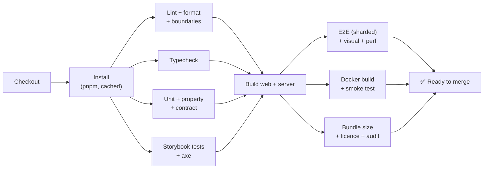
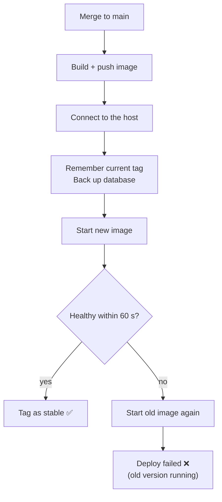

# CI, Docker, deploy and rollback

> **In short:** Every push, to any branch, runs all checks and builds the Docker image. `main` only takes commits whose checks passed. Merging to `main` publishes the image to GitHub's registry. A deploy job updates the host, waits for a health check, and **rolls back by itself** if the check fails. Rolling back by hand is one button.

## CI on every push

Today CI runs lint, typecheck and the tests (`.github/workflows/ci.yml`). The other jobs below are
added as the apps they check arrive.



| Job                        | Fails the run when                                                             |
| -------------------------- | ------------------------------------------------------------------------------ |
| Lint                       | ESLint, Prettier or the boundaries test fails                                  |
| Typecheck                  | `tsc` finds an error                                                           |
| Unit / property / contract | Any test fails, or coverage drops under target                                 |
| Storybook                  | A play test or an axe check fails                                              |
| E2E                        | A journey fails in any browser                                                 |
| Visual                     | Screenshots differ (new ones are approved by updating them on purpose)         |
| Perf                       | A budget is broken (warning on branches, failure on `main`)                    |
| Docker                     | The image doesn't build, or `/health` doesn't answer in 30 s                   |
| Bundle / audit             | First load JS > 400 KB gzip, a high-severity advisory, or a disallowed licence |

## Branches and versions

- Work happens on a branch. CI runs on every push to it.
- `main` is protected by a GitHub ruleset: **required status checks** (the `check` job), **block
  force pushes**, **restrict deletions**, and an empty bypass list. GitHub then refuses any commit
  on `main` whose checks haven't passed, from anyone. No pull request or review is needed.
- To merge: rebase the branch on `main`, wait for green checks, then fast-forward `main` to it
  (`git switch main && git merge --ff-only <branch> && git push`). It must be a fast-forward:
  a merge commit is a new commit with no checks, so GitHub would refuse it.
- Outside contributors can't push to the repo, so they open a pull request from a fork. Its checks
  must pass before it can be merged. CI runs for a first-time contributor only after you approve
  it (GitHub's default).
- Versions follow **SemVer**. **Changesets** writes the changelog.
- Every image gets two tags: `sha-<short commit>` and, on release, `vX.Y.Z`. The deployed one also gets `stable`.

## The Docker image

```dockerfile
# docker/Dockerfile (sketch)
FROM node:22-bookworm-slim AS build
WORKDIR /src
RUN corepack enable
COPY . .
RUN pnpm install --frozen-lockfile \
 && pnpm --filter @glade/web build \
 && pnpm --filter @glade/server build        # bundles the server and the packages' TS source with esbuild

FROM node:22-bookworm-slim
RUN useradd --system --uid 10001 glade
WORKDIR /app
COPY --from=build /src/apps/server/dist ./
COPY --from=build /src/apps/web/dist ./public
USER glade
ENV NODE_ENV=production PORT=8080 DATA_DIR=/data
EXPOSE 8080
HEALTHCHECK --interval=30s --timeout=3s CMD node healthcheck.js
CMD ["node", "main.js"]
```

**Notes:** Debian slim (not Alpine) because SQLite's native module builds easily there. Packages are TypeScript with no build step, so the server build bundles them.

```yaml
# docker/compose.yml (example)
services:
  glade:
    image: ghcr.io/umushiumushi/glade:${GLADE_TAG:-stable}
    restart: unless-stopped
    read_only: true
    tmpfs: [/tmp]
    env_file: ./glade.env # BETTER_AUTH_SECRET, BETTER_AUTH_URL, GOOGLE_CLIENT_ID, GOOGLE_CLIENT_SECRET, GLADE_NTFY_URL, GLADE_NTFY_TOKEN
    volumes:
      - ./data:/data
    mem_limit: 512m
    labels:
      - com.centurylinklabs.watchtower.enable=false # the deploy job updates Glade, not Watchtower
    ports:
      - "127.0.0.1:8080:8080" # behind a reverse proxy that serves HTTPS
```

Any reverse proxy works (Caddy, nginx, Traefik). It adds HTTPS and HSTS.

**Automatic image updaters (like Watchtower) must leave Glade alone.** The deploy job below does
what they don't: it backs up the database first, checks health, and puts the old version back if
the new one is broken. If both ran, they would fight over the same container. The label above tells
Watchtower to skip Glade.

## Deploy (automatic, after merge to `main`)

1. CI builds and pushes `ghcr.io/…/glade:sha-abc123`.
2. The deploy job connects to the host over a private network (short-lived credentials).
3. It logs in as a `deploy` user that may run only one script: `glade-deploy <tag>`.
4. The script:
   1. Writes down the current tag (for rollback).
   2. Backs up the database (`sqlite3 .backup`).
   3. Pulls the new image.
   4. Runs `docker compose up -d` with the new tag.
   5. Calls `/api/v1/health` every 2 s for up to 60 s.
   6. ✅ Healthy: tags it `stable`, done.
   7. ❌ Not healthy: starts the old tag again, checks health, and marks the job failed.
5. GitHub shows the result.



## Rollback by hand

- GitHub → Actions → **Rollback** → pick a version from the list → Run.
- It runs the same `glade-deploy <old tag>` script.
- Works because database changes only **add** things ([storage](../server/README.md#storage)). An older app ignores new columns.
- If a migration ever must remove something, it ships in **two releases**: first stop using it, later remove it.

## Backups

| What         | How                                                                   | When                             |
| ------------ | --------------------------------------------------------------------- | -------------------------------- |
| `glade.db`   | `sqlite3 .backup` to `data/backups/` (users, sessions, drafts, index) | Before every deploy, and nightly |
| Blob files   | Already immutable (hash-named)                                        | —                                |
| Off-site     | Copy the `data` folder to off-site storage                            | Nightly                          |
| Restore test | Restore last night's backup into a temp container and call `/health`  | Monthly (scheduled CI job)       |

## Feature flags

- A small `flags.json` in `/data` (and defaults in code).
- Risky features ship behind flags: `terrain.sculpt`, `builder.curves`, `signin.google`.
- Changing a flag needs no redeploy: the server reads the file every minute and the app fetches flags on load.

## Monitoring

| Metric (`/metrics`)                                  | Alert when              |
| ---------------------------------------------------- | ----------------------- |
| `http_requests_total` by route and status            | 5xx rate > 1% for 5 min |
| `http_request_duration_seconds`                      | p95 > 500 ms for 10 min |
| `glade_uploads_total`, `glade_upload_rejected_total` | Rejections spike        |
| `glade_reports_total`                                | Any new report (info)   |
| `glade_abuse_reports_open` (backup for ntfy)         | Above 0 for a day       |
| `glade_notify_failed_total`                          | Any failure             |
| `glade_disk_bytes`                                   | Data folder > 20 GB     |
| Container up (cAdvisor)                              | Down for 2 min          |

Any Prometheus-compatible monitor can scrape `/metrics`. A Grafana dashboard is planned with the server.
