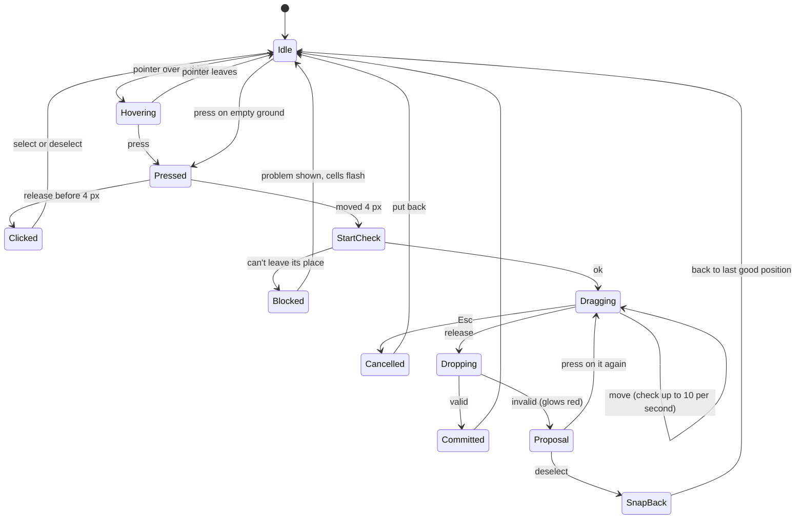

# How the planner behaves

> **In short:** Pick what to work on (the mode). Choose Camera or Pointer. Select things with a select tool or by clicking. Drag to move. Bad moves glow red and snap back. Every action is one undo step.

## Camera and cursor controls

### Desktop

| Input                    | Does                                                                            |
| ------------------------ | ------------------------------------------------------------------------------- |
| Camera tool + left drag  | 3D: orbit around the centre of the view. 2D: pan.                               |
| `W` `A` `S` `D`          | Move the camera forward, left, back, right (slides, does not spin).             |
| Arrow keys               | Same as WASD, unless the keyboard cursor is on ([Full key map](#full-key-map)). |
| `Q` / `E`                | Turn the camera left / right.                                                   |
| Scroll wheel             | Zoom. (Settings can switch the wheel to pan.)                                   |
| Trackpad pinch           | Zoom.                                                                           |
| Trackpad two-finger move | Pan.                                                                            |
| Middle mouse drag        | Pan, with any tool.                                                             |
| Hold `Shift`             | Swap Camera ↔ Pointer while held.                                               |
| Right click              | Open the actions menu for the selection, the picked item, or the hovered item.  |

### Touch (phones and tablets)

| Gesture                             | Does                                                            |
| ----------------------------------- | --------------------------------------------------------------- |
| Camera tool + one finger drag       | Orbit around the centre (3D) or pan (2D).                       |
| Two finger drag                     | Pan, with any tool.                                             |
| Pinch / spread                      | Zoom, with any tool.                                            |
| Two finger twist                    | Turn the camera.                                                |
| Pointer or select tool + one finger | Use the tool (pick, drag, draw a selection).                    |
| Long press (500 ms)                 | Open the actions menu. A small ring fills up to show the press. |
| Tap an icon                         | Show its name and flyout (replaces hover).                      |
| Two finger tap                      | Undo (optional, off by default).                                |

## Selecting

### The basics

1. A select tool makes or changes the **selection**.
2. **Set** replaces it. **Add** joins it. **Subtract** cuts from it.
3. Holding `Ctrl`/`⌘` adds for one stroke. Holding `Alt`/`⌥` subtracts for one stroke.
4. The selection is shown with a blue outline. With the ruler on, its size shows on the edges ("6 × 4 tiles").
5. Click inside the selection (without dragging) to clear it.
6. Drag inside the selection to move it ([Moving things](#moving-things)).

### What each tool picks, per mode

| Mode       | Lasso / Rectangle / Circle                                                                                                                                                     | Magic (click)                                                                                           |
| ---------- | ------------------------------------------------------------------------------------------------------------------------------------------------------------------------------ | ------------------------------------------------------------------------------------------------------- |
| **Items**  | Every house, furniture piece and plant whose footprint touches the shape.                                                                                                      | All connected items of the same kind (e.g. a whole fence line), or a group of touching items.           |
| **Paths**  | Every tile in the shape where a path can go (on the map, not beach, not landmark). Empty tiles count, so you can fill them later.                                              | All connected path tiles of the same type. On empty ground: the connected flat area where paths can go. |
| **Cliffs** | Flat ground: the **top block** of every cell inside. With cliffs: only the cliffs that have a **cliff face** inside the shape, not the ground below. Things on top come along. | Everything that shares a cliff face, plus whatever stands on it (other cliffs, items, water).           |
| **Water**  | Every water block inside, including the edge block that makes a waterfall.                                                                                                     | The whole connected water body.                                                                         |

**"Select ground too":** in Cliffs mode, after picking cliffs, this action adds the ground inside the shape: the top ground block of every cell, including the ground block under each picked cliff.

### Selected blocks (Cliffs mode)

A terrain selection picks **blocks**, not whole columns. For each cell it holds how many blocks are
selected, counted down from the top.

| What is picked           | Blocks selected in that cell                                           |
| ------------------------ | ---------------------------------------------------------------------- |
| A cliff                  | Every block of the cliff: from its top down to the ground it stands on |
| Ground (flat, or "too")  | The top ground block: 1                                                |
| A cliff, with ground too | The cliff's blocks, plus the ground block under it                     |

**Example:** a 3 × 3 cube, 3 blocks tall, on flat ground at level 4. Its top is level 7.

| You select                                   | Cube cells     | Ground cells    |
| -------------------------------------------- | -------------- | --------------- |
| Magic, or Pointer click on the cube          | 3 blocks each  | —               |
| Lasso over one corner column and some ground | That column: 3 | — (cliffs only) |
| The same lasso, then **Select ground too**   | That column: 4 | 1 each          |

Every terrain action works on these selected blocks: Delete removes them, lift and drop carries
them, Raise / lower moves them.

**Things on terrain come along:** a terrain selection always includes the plants, furniture, houses and paths standing on it.

### Switching modes keeps the selection

The selection is stored as an **area** (a set of half-tile cells), not as a list of things.

Example:

1. In Cliffs mode, you lasso a mountain.
2. You switch to Paths mode.
3. The same area stays selected, but now it means "the path tiles in this area".
4. Even if there are no paths there, the selection stays. You can use Fill to fill it.
5. Moving an empty selection adds a note to the problems chip: "Nothing to move here in Paths mode".

## Moving things

### Step by step (mouse)

1. Press on a selected thing (or any thing, with the Pointer tool).
2. Move more than 4 px (8 px on touch). This starts a drag. Less than that counts as a click.
3. **Start check:** Glade checks if the thing can leave its place at all.
   - If not (for example, it is locked by a landmark rule): the cells that cause the problem flash red, the problems chip explains why, and nothing moves.
4. While dragging, a copy follows the cursor, snapped to the mode's grid.
5. Glade checks the new spot in the background, up to 10 times a second.
   - Valid: normal look.
   - Invalid: red outline and a ⚠ icon above it.
6. Let go.
   - Valid: the move commits. One undo step.
   - Invalid: the thing **glows red** and stays there as a proposal. Click elsewhere (deselect) and it returns to its **last good position**. Or keep dragging to fix it.
7. `Esc` at any time cancels and puts everything back.

The cursor shows what will happen: open hand (can grab), closed hand (dragging), no-entry (can't move).

### Which layer wins

Glade orders things as **furniture → terrain → paths**. Things higher in the list can move without caring about the ones below.

| You move      | Onto furniture                                                                         | Onto raised land                                                                                         | Onto paths                                                                     |
| ------------- | -------------------------------------------------------------------------------------- | -------------------------------------------------------------------------------------------------------- | ------------------------------------------------------------------------------ |
| **Furniture** | ❌ Not allowed (overlap)                                                               | ✅ Sits on top. Must be flat and dry.                                                                    | ✅ Allowed. Plants only on paths that allow plants.                            |
| **Terrain**   | ❌ Not allowed where furniture stands (unless that furniture is part of what you move) | Lift and drop: the piece replaces the land. Sculpt (later): merges ([Shaping terrain](#shaping-terrain)) | ✅ The paths under it are erased. A note says how many. Undo brings them back. |
| **Paths**     | Allowed (paths can run under items, if rules allow)                                    | ✅ Paths go **on top** of land (must be flat and dry)                                                    | Replaces the old path there                                                    |

A path can never end up **under** a terrain block.

## Shaping terrain

> **In short:** Four ways to change terrain. The **brush** and **eraser** add or remove one layer,
> stopping at every edge. The **Raise / lower** slider moves a selection of land or water up and
> down. **Lift and drop** moves a piece of land. **Sculpt** (after 1.0) lets land merge into other
> land. Everything happens live: when a change needs terraces, Glade shows them while you work and
> keeps them when you let go. There is no separate "settle" step.
>
> **The selection comes first.** Raise / lower never changes a block outside the selection: its
> terraces are made from the selection's own edge. Moving land (lift and drop, rotate, sculpt) may
> change the ground around the piece, because the piece has to fit where it lands.

| Way                   | Control                    | What changes                                 | Adds terraces?                           | When a block can't change            |
| --------------------- | -------------------------- | -------------------------------------------- | ---------------------------------------- | ------------------------------------ |
| Brush / eraser        | Toolbox, drag on the map   | One layer: only blocks at the stroke's level | No                                       | Red stripes on it + a problem        |
| Raise / lower (land)  | Selection → slider         | The selected land, by whole levels           | Yes, live, **inside the selection only** | Skipped, striped, a note counts them |
| Raise / lower (water) | Selection → slider         | The selected water, by whole levels          | Yes, live, **inside the selection only** | Skipped, striped, a note counts them |
| Lift and drop         | Selection → drag           | A piece of land moves to a new place         | Yes, live, around the piece              | The piece glows red                  |
| Sculpt (after 1.0)    | Selection → drag into land | Two pieces of land merge into a new shape    | Yes, live, around the piece              | The piece glows red                  |

All terrain is one height per block (0 to 8), with an optional water block on top
([Petit Planet's terrain](../profiles/petit-planet.md#per-map)).

### Brush and eraser (one layer)

The brush draws **one flat layer**. The stroke's **level** is the level of the block where you
press. Only blocks at exactly that level change. Lower and higher blocks are left alone, so every
edge acts as a border.

**Example:** you press on a block at level 2 and paint across the whole row.

| Block  | A   | B   | C   | D   | E   |
| ------ | --- | --- | --- | --- | --- |
| Before | 1   | 2   | 2   | 2   | 3   |
| After  | 1   | 3   | 3   | 3   | 3   |

A (level 1) and E (level 3) are not the stroke's level, so they stay as they are.

1. **Size** is the brush's width only. A stroke never adds more than one level, however often it
   passes over a block.
2. A block at the stroke's level that **can't** change shows a **red striped overlay** while you
   paint, and the problems chip explains why. Examples: rule T3 (too steep), a landmark, the beach,
   part of an item standing on it, already at level 8.
3. The brush never changes other blocks to make room. No terraces.
4. Letting go commits every block that could change. The stroke is one undo step.

| Tool   | Cliffs mode                                                                            | Water mode                                             |
| ------ | -------------------------------------------------------------------------------------- | ------------------------------------------------------ |
| Brush  | Raises land at the stroke's level by 1. Water blocks are borders too.                  | Adds water on dry blocks at the stroke's level.        |
| Eraser | Lowers land at the stroke's level by 1. Press on level 3: only level 3 blocks go to 2. | Removes water from water blocks at the stroke's level. |

### Raise and lower (land)

1. Select an area (Cliffs mode).
2. In the actions menu, use the **Raise / lower** slider.
3. The selected shape goes up or down by whole levels.
4. **Nothing outside the selection changes.** If a step at the selection's edge would break the step
   limit (T3), the selection's own edge blocks are held back to make **terraces inside it**, live.
   They show purple while you slide and become real when you let go.
5. Blocks that can't move are skipped and shown with stripes:
   - under items that are only partly inside the selection;
   - landmark and beach blocks;
   - blocks already at the top (8) or bottom (0);
   - blocks the step limit holds where they are.
6. A note in the problems chip counts skipped blocks: "12 blocks skipped: under items".
7. **Note:** if you lower a cliff and then raise it, it rises in the shape of the **selection**, not its old shape. Use Undo to get the old shape back.

**Example:** flat ground at level 1, step limit 3.

| You select and raise | Result                                                                                       |
| -------------------- | -------------------------------------------------------------------------------------------- |
| One block, by 4      | That block goes up 3 (the limit) and stops. No block around it changes.                      |
| A 5 × 5 square, by 6 | Its edge ring goes to 4, everything inside it to 7. The ground around the square stays at 1. |

**Items on raised ground:** when an item's whole footprint is inside the selection, its blocks move together, so it stays flat.

### Raise and lower (water)

Water is always one block deep, on top of land. But a pond can sit low: dig a hole 3 levels deep
with the eraser, then fill its bottom with the water brush.

1. Select water (Water mode). Magic selects a whole water body.
2. In the actions menu, use the **Raise / lower** slider.
3. **Raise:** the water goes up, and the land under it rises with it, so the water stays one block
   deep. Water can rise until it is level with the land around it (the cliff surface), never
   above. Blocks that would pass it are skipped and striped.
4. **Lower:** the water goes down, with the land under it. The banks never change: where a bank
   would be too steep (T3), the pond's own edge is held back, so the pond gets terraces inside.
5. Waterfall rules (W2, W4) are checked live too.

**Example:** a 4 × 4 pond in ground at level 5.

| Step               | Pond middle (water level)                     | Pond edge                               | Bank |
| ------------------ | --------------------------------------------- | --------------------------------------- | ---- |
| Start              | 2                                             | 2                                       | 5    |
| Raise by 3         | 5 (level with the ground: as high as it goes) | 5                                       | 5    |
| Raise by 1 more    | Skipped: can't pass the land around it        | 5                                       | 5    |
| Lower to 1 instead | 1                                             | **2** (held back: 5 − 2 = 3, the limit) | 5    |

### Lift and drop

> Lift and drop and its live terraces are in 1.0, with no feature flag.

1. Select land in Cliffs or Water mode.
2. Drag it. Glade "lifts" the piece:
   - its heights (as steps above the ground around it),
   - its water,
   - its corner shapes,
   - everything on top (items, plants, paths).
3. The hole it leaves becomes **base level** (the most common height around the hole).
4. A see-through copy follows the cursor, snapped to blocks.
5. While you drag, Glade works out the **smallest change** to the ground around the piece that
   makes the drop valid, and shows it as see-through purple with stripes (temporary terrain):
   - steps too tall (rule T3) → add terraces;
   - waterfall face too short (W2) → widen the cliff face;
   - corner shapes that can't exist (T5) → square them.
6. Drop it. The piece replaces the land under it, and the temporary terrain becomes real, in one
   undo step. Paths under it are erased.
7. If even temporary terrain can't fix it (for example, a landmark or the beach is in the way), it
   glows red instead. Deselect to return it to its last good position.

**Example:** a long mountain. Select its tail. Drag it 6 blocks away. Now you have two mountains. Drag it only 1 block: the mountain just changes shape.

**How terraces are found (simple version):**

- Every block near the change gets a lowest and highest allowed height, so that no neighbour is more than 3 levels away.
- Glade computes these limits by spreading out from the change, one ring at a time (like ripples).
- Each block is then clamped between its limits. Blocks already inside the limits don't change.
- This is fast: one pass over a small area, well under 5 ms, so it runs on every drag update.

Raise / lower uses the same ripples, but only inside the selection: the blocks around it are the
fixed edge, and the selection's own blocks are held back.

### Sculpt (after 1.0, research)

Sculpt lets blocks **merge into each other**, forming a new shape.

| Situation                                                                             | Result                                                                                                                   |
| ------------------------------------------------------------------------------------- | ------------------------------------------------------------------------------------------------------------------------ |
| Drag a land piece **into** another mountain                                           | **Blend:** the two join. The taller height wins in each block. The first mountain gets shorter because its tail is gone. |
| Drag a waterfall into the **curved face** of another water mountain, and keep pushing | **Carve:** the piece's shape wins. The other mountain gets a dent and reshapes around the waterfall.                     |
| Select part of a cliff face and drag it **inward**                                    | **Push face:** the face moves inward; the blocks behind it get lower.                                                    |
| Select part of a cliff face and drag it **outward**                                   | **Pull face:** the face moves out; new blocks are added at the cliff's height.                                           |

Default: Blend for land, Carve for water. A small toggle in the actions menu changes it.

**Order of priority:** the thing you are moving always wins over the land it lands on.

> Sculpt needs research ([roadmap, Phase 9](../roadmap.md#phase-9-research-features-l-ongoing)).
> Until then, dropping land onto land replaces it (lift and drop).

## Rotate

`[` and `]`, or the rotate buttons on the [selection bar](screen.md#selection-bar-and-actions-menu),
turn a selection 90° left or right. It works in every mode.

| Mode          | What turns                                                                                                                                         |
| ------------- | -------------------------------------------------------------------------------------------------------------------------------------------------- |
| Items         | Each picked item turns in place.                                                                                                                   |
| Paths         | The selected path tiles turn around the selection's centre, with their corner shapes.                                                              |
| Cliffs, Water | The selected piece of land turns around its centre, with **everything on it**: heights, water, waterfalls, corner shapes, items, plants and paths. |

Turning terrain works like [lift and drop](#lift-and-drop) without moving: Glade lifts the piece,
turns it, and puts it back in the same place.

1. If the turned piece needs terraces to fit, Glade adds them **live**, shown purple, and keeps
   them. Same undo step.
2. If even terraces can't make it fit (a landmark or the beach is in the way), it glows red.
   Deselect to return it to how it was.

**Example:** an L-shaped cliff with a waterfall facing east. Press `]`. The cliff turns into the
other L, the waterfall now faces south, and a tree on the cliff stays on the same block of the
cliff.

The centre is the middle of the selection's bounding box. When that falls between blocks, the
turned piece snaps to the block grid.

## Copy, paste, duplicate, delete

**Delete in Cliffs mode, worked through** (the cube from [selected blocks](#selected-blocks-cliffs-mode): top 7, ground 4):

| Selection                              | Delete does                                        | Result                                              |
| -------------------------------------- | -------------------------------------------------- | --------------------------------------------------- |
| The whole cube (Magic or Pointer)      | Each cube cell: 7 − 3 = 4                          | The cube is gone; flat ground at 4                  |
| One corner column (lasso, cliffs only) | That cell: 7 − 3 = 4                               | The corner column is gone                           |
| The same, plus **Select ground too**   | The column: 7 − 4 = 3. Each ground cell: 4 − 1 = 3 | A 1-deep hole where the corner and that ground were |
| Flat ground only                       | Each cell: 4 − 1 = 3                               | A 1-deep hole                                       |

If the result breaks a rule (a step taller than 3, say), Glade adds terraces live, as with any
terrain change.

| Action    | Keys                                              | Does                                                                                                                                                                                                                                                                  |
| --------- | ------------------------------------------------- | --------------------------------------------------------------------------------------------------------------------------------------------------------------------------------------------------------------------------------------------------------------------- |
| Copy      | `Ctrl/⌘ + C`                                      | Copies the selection or picked item, with everything in its scope.                                                                                                                                                                                                    |
| Cut       | `Ctrl/⌘ + X`                                      | Copy, then delete.                                                                                                                                                                                                                                                    |
| Paste     | `Ctrl/⌘ + V`                                      | The copy follows the cursor. Click to drop. `[` `]` rotate it. `Esc` cancels. Terrain pastes like [lift and drop](#lift-and-drop): it replaces the land under it, with live terraces.                                                                                 |
| Duplicate | `Ctrl/⌘ + D`                                      | Copy and paste next to the original.                                                                                                                                                                                                                                  |
| Delete    | `Delete` / `Backspace`, or 🗑 on the selection bar | Items: removes them. Paths: clears them. Cliffs: removes the **selected blocks**: each cell drops by the number of blocks selected in it ([selected blocks](#selected-blocks-cliffs-mode)), with live terraces if the result breaks a rule. Water: removes the water. |

Copies also go to the system clipboard as JSON, so you can paste between browser tabs and between maps.

## The Pointer tool as a state machine

Every tool is a state machine. This one shows the Pointer tool. Every event is handled in every state, so nothing is missed.

## Full key map

All keys can be changed in **Settings → Controls**. On Mac, `Ctrl` means `⌘` and `Alt` means `⌥`.

### Tools and modes

| Key                         | Action                           |
| --------------------------- | -------------------------------- |
| `H`                         | Camera                           |
| `V`                         | Pointer                          |
| Hold `Shift`                | Swap Camera ↔ Pointer while held |
| `L`                         | Lasso                            |
| `M`                         | Rectangle                        |
| `O`                         | Circle                           |
| `Y`                         | Magic                            |
| Hold `Ctrl` while selecting | Add                              |
| Hold `Alt` while selecting  | Subtract                         |
| `1` `2` `3` `4`             | Items, Paths, Cliffs, Water mode |
| `B`                         | Brush                            |
| `X`                         | Eraser                           |
| `G`                         | Fill                             |
| `T`                         | Cut corners                      |
| `R`                         | Ruler on/off                     |

### Camera and view

| Key             | Action                                             |
| --------------- | -------------------------------------------------- |
| `W` `A` `S` `D` | Move camera                                        |
| Arrows          | Move camera (or the keyboard cursor when it is on) |
| `Q` / `E`       | Turn camera left / right                           |
| `+` / `-`       | Zoom in / out                                      |
| `F`             | Fit (selection, or whole map)                      |
| `Tab`           | 2D / 3D                                            |
| `P`             | Preview on/off                                     |

### Editing

| Key                              | Action                                                        |
| -------------------------------- | ------------------------------------------------------------- |
| `Ctrl + Z`                       | Undo                                                          |
| `Ctrl + Y` or `Ctrl + Shift + Z` | Redo                                                          |
| `Ctrl + C` / `X` / `V` / `D`     | Copy / cut / paste / duplicate                                |
| `Delete` / `Backspace`           | Delete                                                        |
| `[` / `]`                        | Rotate the selection left / right                             |
| `Esc`                            | Cancel drag or paste → else close menu → else clear selection |
| `Shift + F10` or Menu key        | Actions menu                                                  |
| `/`                              | Search items                                                  |

### Getting around the screen

| Key                     | Action                                                           |
| ----------------------- | ---------------------------------------------------------------- |
| `F6`                    | Jump between regions: panel → viewport → toolbox → viewport menu |
| `Tab` / `Shift + Tab`   | Next / previous control (inside the side panel and toolbox)      |
| Arrows inside a toolbar | Move between buttons                                             |
| `F8`                    | Open the problems tray at the newest message                     |
| `?`                     | Show this key map                                                |

**Note on `Tab`:** inside the viewport, `Tab` switches 2D/3D . Use `F6` to leave the viewport. This is shown in the key map and in the guide.

### The keyboard cursor (for keyboard-only use)

1. It turns on when you move into the viewport with `F6`, or when you press `K`.
2. A square cursor shows on the map, on the current mode's grid.
3. Arrows move it one cell. The camera follows it at the edges.
4. `Enter` picks or selects what is under it. `Shift + arrows` grows a rectangle selection.
5. `Space` picks up the selection. Arrows move it. `Enter` drops it. `Esc` cancels.
6. It turns off when you use the mouse, or press `K` again.
7. Screen readers hear what is under it: "Tile 34, 40. Grass, level 1. Chair."

## User journeys

### J1: Place a chair (mouse)

1. Press `1` (Items mode).
2. In the toolbox, click the **Seating** tab.
3. Drag **Chair** onto the map. A see-through chair follows the cursor and snaps to half tiles.
4. Press `]` to turn it.
5. Let go. The chair is placed. "Undo: place chair" is now possible.

### J2: Place a chair (keyboard only)

1. `F6` until the toolbox is focused. `/` and type "chair". `Enter` on the chair card.
2. The keyboard cursor appears on the map with a see-through chair.
3. Arrows to move it. `]` to turn it.
4. `Enter` to place. `Esc` to stop placing.

### J3: Split a mountain in two

1. Press `3` (Cliffs mode). Choose **Lasso** (`L`).
2. Draw around the tail of the mountain. Its cliff blocks and the trees on it are selected.
3. Drag the selection 6 blocks to the east.
4. The hole becomes base level. The tail lands as its own mountain.
5. If a step is too steep, Glade shows purple temporary terraces. Let go to keep them.

### J4: Paint a path and round its corners

1. Press `2` (Paths mode). Choose **Brush** (`B`). Pick **Cobble** in the palette.
2. The **Size** slider appears next to the tools. Set it to 2.
3. Paint a path across the grass.
4. Choose **Cut** (`T`), then **Round**. Dots show on the corners that can be shaped.
5. Click a corner dot. It turns round.

### J5: Raise a garden by one level

1. Press `3` (Cliffs mode). Rectangle (`M`). Drag over the garden.
2. The actions menu opens. Drag the **Raise / lower** slider up one notch.
3. The garden rises. Items fully inside rise with it. If needed, the garden's own edge steps down to the ground around it; the ground outside never changes.
4. A note says "4 blocks skipped: under items" if some items were only partly inside.

### J6: Dig a pond and raise its water

1. Press `3` (Cliffs mode). Choose **Eraser**.
2. Press on the grass (level 5) and paint a 4 × 4 area. It drops to 4. Paint again three times: 3, then 2.
3. Press `4` (Water mode). Choose **Brush**. Press on the hole's bottom (level 2) and paint it. It fills with water.
4. Magic-select the pond. Drag the **Raise / lower** slider up 2 notches. The pond rises to 4.
5. Drag it up once more: the pond reaches 5, level with the grass. One more notch: a note says the water can't rise above the land around it.

## Things on tables (surfaces)

> **In short:** Some items have a top that small things can stand on: tables, stalls, counters. Drop a small thing on a table and it stays on that table. Move the table and everything on it comes along.

**What the profile says**

| Word           | Meaning                                                                   |
| -------------- | ------------------------------------------------------------------------- |
| Surface        | An item with a top grid, like a table (`surface: { w, h }` in half cells) |
| Placeable      | A small thing that can stand on a surface (`placeable: { w, h }`)         |
| Nothing stacks | An item has a surface **or** is placeable, never both                     |

**How it works in Items mode**

1. Drag a placeable item (a cup) over a table.
2. The table's top shows its own small grid. The cup snaps to it.
3. Drop it. The cup is stored on the table (layer `onSurfaces`, with the table's id).
4. Drag the cup off the table onto the ground: it becomes a normal item again, if it can stand on the ground.
5. Move or turn the table: things on it move and turn with it. One undo step.
6. Delete the table: things on it are deleted too. A note says how many. Undo brings them back.

**Rules:** S1 (only placeable things, only on surfaces), S2 (fits wholly on the top), S3 (no overlap on one top). Friendly text is in [Petit Planet's rule text](../profiles/petit-planet.md#friendly-rule-text).

**Selecting:** a click picks the thing on top first. Click again (or press `Alt` + click) to pick the table under it.

## Homes (after 1.0)

Homes reuse everything in this section. Only these parts are new:

| Part                   | How it works                                                                                                                     |
| ---------------------- | -------------------------------------------------------------------------------------------------------------------------------- |
| Wall items             | Snap to half cells across and up the wall. They don't turn. They must stay clear of doors (rule H2).                             |
| Ceiling items          | Placed from below, like floor items. They turn like floor items.                                                                 |
| Wallpaper and flooring | Pick a room (click it in Decor mode), then click a swatch. One of each per room (rule H4).                                       |
| Camera                 | Walls hide while the camera is behind them (the profile's 3D view does this), so a room looks like a doll's house from any side. |
