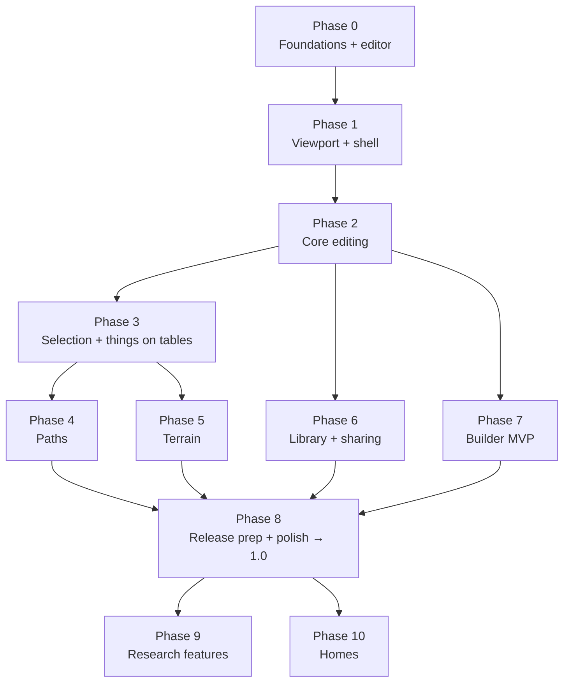

# Roadmap

> **In short:** 11 phases. Foundations and logging come first, then the shell, then editing,
> selection, paths, terrain, sharing, the builder, polish, and finally the research features.
> Phases 0–6 give a usable, shareable planner. Phases 7–8 add the builder and make it 1.0. Homes
> come after 1.0, in Phase 10. The game profiles already exist, so most phases build on them.

Sizes: **S** = about 1 week, **M** = 2–3 weeks, **L** = 4–6 weeks (one person, part-time guesses).

## Done

- The repo, the pnpm workspace, TypeScript, ESLint, Prettier, the boundary and references tests,
  and CI (lint, typecheck, tests).
- The shared profile packages: `@glade/core`, `@glade/render`, `@glade/three`, `@glade/testkit`.
- Petit Planet's profile: the island and two home layouts, every rule with a test, the look, and
  render goldens.
- From Phase 0: the code style enforced (lint, file headers, coverage per package, property tests);
  `@glade/errors`, `@glade/logging`, `@glade/formats`, `@glade/edit`; `@glade/ui` with Storybook and
  story tests in Chromium; `@glade/petit-planet-ui` (theme, fonts, icons); the skeletons of
  `apps/web` and `apps/server` (`/api/v1/health`); a real-size island and its made-up catalog,
  made by a seeded generator. Phase 0 is done, apart from Docker and deploy (moved to Phase 8).

## Phase 0: Foundations (M)

| Deliverables                                                                                                          |
| --------------------------------------------------------------------------------------------------------------------- |
| `packages/errors`: `Result`, the error shape, the error registry                                                      |
| `packages/logging`: event registry, logger, IndexedDB sink, `.gladelog` writer, redaction tests                       |
| `packages/ui`: design tokens, Button, IconButton, Toggle, Toolbar, Tooltip, Menu, Slider, Dialog in Storybook         |
| `packages/edit`: draft, patch, transaction, history, with the recording draft ([editing](edit/README.md)). Game-free. |
| CI jobs that apply so far ([CI](engineering/ci-and-deploy.md))                                                        |
| App skeletons: `apps/web` and `apps/server` (with `/health`)                                                          |
| Fixtures: a real-size island map and catalog                                                                          |
| ESLint import rules for the catalog, edit and ui packages, as they are added                                          |

**Exit:** CI green. Storybook builds. Editor tests pass, including "op then undo = start".

Docker, deploy and rollback wait for [release prep](#phase-8-release-prep-polish-and-audit-m--10).

## Phase 1: Viewport and the shell (M)

| Deliverables                                                                                                                      |
| --------------------------------------------------------------------------------------------------------------------------------- |
| `packages/viewport`: 2D host (canvas + `plan.draw`), 3D host (`MapScene`), render loop, FPS counter, look from time and season    |
| Shell layout: side panel, rail, phone top bar, viewport chrome, toolbox frame, viewport menu, preview, FPS/coords                 |
| Routing `/<game>/planner`, the game registry, game picker, theming, a generic home page stub at `/`                               |
| The `_fixture` game's UI (both its maps) and Petit Planet's `ui` package with the island's UI (theme, modes, layers, environment) |
| Camera tool, WASD, Q/E, zoom, touch gestures; time slider + sky dome; snow; layers                                                |
| Settings window (skeleton), Menu (skeleton)                                                                                       |

**Exit:** a real-size island opens in 2D and 3D on desktop and a real phone. The fixture's 2D-only
map opens with no 3D switch. Every panel control works by keyboard. No axe errors. FPS and first 3D
build time measured on target devices (decides T-4).

## Phase 2: Core editing (L)

| Deliverables                                                                           |
| -------------------------------------------------------------------------------------- |
| Editor worker, worker bridge, mirror (new map object per patch), crash recovery        |
| The pipeline ([planner internals](planner/internals.md)) with log events for each step |
| Shared object ops in `packages/edit` (place, move, rotate, remove) used by the island  |
| Profile tasks T-1 (houses and furniture layers) and T-2 (split the items chunk)        |
| Pointer tool, hover/select highlights, drag move with live checks, rotate, delete      |
| Item drawer: tabs, cards, thumbnails, search, click-to-place, keyboard place           |
| `@glade/petit-planet-catalog`: base items with categories, bound with `bind`           |
| Problems chip and tray + rule text for every rule                                      |
| Undo/redo, autosave, New/Open/Save locally                                             |

**Exit:** journeys J1 and J2 pass in e2e. Transaction < 10 ms on an Apple M4. Worker crash
recovery tested.

## Phase 3: Selection, and things on tables (M)

| Deliverables                                                                                                                    |
| ------------------------------------------------------------------------------------------------------------------------------- |
| Rect, circle, lasso, magic; set/add/subtract; selection mask; mode switching keeps it                                           |
| Selection and spotlight overlays in the viewport; screen-to-ground with `MapScene.pick`                                         |
| Actions menu (all modes), copy/cut/paste/duplicate, ruler                                                                       |
| Keyboard cursor                                                                                                                 |
| Things on tables: drop on a table, move with the table, rules S1–S3 text; a few base tables and small things. Profile task T-3. |

**Exit:** property tests for set maths pass. Keyboard-only selection e2e passes. A cup dropped on a
table moves with the table.

## Phase 4: Paths (S–M)

Brush, eraser, fill, cut; palette; brush settings; see-through items in Paths mode. **Exit:** J4
passes.

## Phase 5: Terrain (L)

| Deliverables                                                                                                                                                                                                                                                         |
| -------------------------------------------------------------------------------------------------------------------------------------------------------------------------------------------------------------------------------------------------------------------- |
| Cliffs and Water tools: one-layer brush and eraser with red stripes for blocked blocks, cut                                                                                                                                                                          |
| Raise / lower slider for land **and water**, with live terraces and skipped-block display                                                                                                                                                                            |
| Lift and drop with live terraces (temporary terrain overlay), last-good-position snap back. In the base release, no flag.                                                                                                                                            |
| Terrain ops in `@glade/petit-planet-edit`: `brushLayer`, `raise` / `lower`, `raiseWater` / `lowerWater`, `transplant`, terraces, live waterfall checks. Built on the profile's `setTerrain`, `isEditableTerrain`, `edgeRun`, `fallSides`, `maxStepBetweenNeighbors`. |
| Layer precedence rules ([moving things](planner/behaviour.md#moving-things))                                                                                                                                                                                         |

**Exit:** J3, J5 and J6 pass. Property test: after any terrain op, rule T3 holds in the changed
area.

## Phase 6: Library and sharing (L)

| Deliverables                                                                                                                                |
| ------------------------------------------------------------------------------------------------------------------------------------------- |
| Accounts: Better Auth with anonymous users and Google, sessions, moving ownership on sign-in, Settings → Account, privacy page              |
| Server: API, SQLite, drafts, snapshot blobs, upload checks, limits, clean-up, metrics                                                       |
| Draft autosave to the server, IndexedDB edit buffer, reload on a newer revision (no conflict dialog)                                        |
| Library window, login screen                                                                                                                |
| Share chip and dialog (Private / Public switch, update shared map), links, draft URLs and the private-map page, view-only mode, make a copy |
| `glade-admin` CLI on the server: stats, abuse cases, hide, ban, delete user                                                                 |
| Abuse reports: Report button, cases, auto-hide, ntfy alerts, `glade-triage` with Claude Code                                                |
| Pack publishing and loading                                                                                                                 |
| Bug reports + `glade-log` CLI (show, filter, timeline, replay)                                                                              |

**Exit:** these pass e2e: save anonymously → share → open on another device → make a copy;
log in on two devices and see the same maps; a stale device reloads the latest version; making a map
private leaves copies working. A report round trip works.

**Milestone: Planner 1.0 beta** (Phases 0–6).

## Phase 7: Builder (L)

| Deliverables                                                                                                                                                                 |
| ---------------------------------------------------------------------------------------------------------------------------------------------------------------------------- |
| `packages/builder`: part tree, faces, layout rules, compile to a model, recipe format                                                                                        |
| Builder window + standalone route; the Define → Build → Save step bar                                                                                                        |
| Templates: Item, Fence / hedge, Building, Tree, Shrub / flower, Crop, Bridge, Incline, Path, Placeable; switching templates converts                                         |
| Basic shapes; Spin and Push with the outline panel; smart parts: Legs, Case, Drawer, Drape, Sling, Cushion, Tube frame, Book row, Handle, Trim, Roof; catalog items as parts |
| Drop onto faces (flat against curves), handles, mirror by default, row and circle repeat                                                                                     |
| Materials and patterns (T-5); markings: Surface and Door (T-7)                                                                                                               |
| Problems panel, save dialog, open from planner, connection preview                                                                                                           |

**Exit:** the seven test items ([builder](builder/README.md#test-items)) pass as e2e tests, each in
no more steps than its recipe. Every compiled recipe passes `entryProblems` (property test).

## Phase 8: Release prep, polish and audit (M) → 1.0

**Release prep** comes first. Until then, CI runs the tests on every push, and nothing is deployed.

| Deliverables                                                                                            |
| ------------------------------------------------------------------------------------------------------- |
| Docker image (the web app and the server), compose file ([CI and deploy](engineering/ci-and-deploy.md)) |
| CI jobs: build, Docker smoke test, bundle size, licence and audit                                       |
| Deploy with automatic rollback, and a **rollback drill**                                                |
| Backups and monitoring                                                                                  |

**Then polish and audit:** real phone testing, manual VoiceOver and NVDA pass, guide content,
performance pass, release checklist, first public release.

## Phase 9: Research features (L, ongoing)

Sculpt (terrain merge, dent, push/pull faces), builder parts that bend to a curve, soft blend,
patterns you draw yourself.

## Phase 10: Homes (L)

| Deliverables                                                                                  |
| --------------------------------------------------------------------------------------------- |
| Home UI: Floor, Walls, Ceiling, Decor modes, layers, rule text, screen reader text            |
| Home ops: floor, wall and ceiling items, coverings, things on tables (shared with the island) |
| New map dialog with map types; library cards show the map type                                |
| Base catalog: wall items, ceiling items, wallpaper, flooring                                  |
| Builder templates: Wall item, Ceiling item, Wallpaper, Flooring                               |

**Exit:** make a home, hang a picture, lay a floor, set a cup on a table, share it, open it on
another device.

## Phase 11: AI apps (MCP) (M)

Needs Phase 6 (accounts and the server). Can move earlier once Phase 6 is done. Pack tools need
Phase 7.

| Deliverables                                                                                                                        |
| ----------------------------------------------------------------------------------------------------------------------------------- |
| Better Auth MCP plugin: app registration, the Allow page, tokens, Settings → Account → MCP section (connected apps, how to connect) |
| `/mcp` (Streamable HTTP) with the fixed tool list, relaying calls to the newest focused tab                                         |
| The live socket (`/api/v1/live`): hello, focus, heartbeat, calls and results                                                        |
| `AppCall` events in the pipeline, the "Claude placed 14 items · Undo" note, the working badge                                       |
| `describe` and `view` text from each game's `ui` package; `get_picture` with an off-screen `MapScene`                               |
| Pack tools, once the builder exists                                                                                                 |

**Exit:** from Claude Code, with Glade open: place 20 items in one `transaction`, see them appear in
the tab at once, undo them with ⌘Z. With Glade closed, every tool answers "Glade isn't open".
([AI apps (MCP)](server/mcp.md))

## Later

The real home page (needs a design) · first-time tutorial overlay · live co-editing · Palworld · Stardew Valley ·
translations · invite editors to a map (signed-in users) · Discord sign-in (Q-27) · custom home layouts (Q-24) · link a house on the island to its
home (Q-25) · item states, like an open window (`itemModel`) · terrain for other games (likely a new terrain model
per game), when they arrive.

## Profile and engine tasks

Changes to the shared profile packages and Petit Planet's profile that the phases above need.
Each keeps the profile rules: shared packages stay game-free, rules stay customizable, every change
has tests.

| Id  | Change                                                                                                                                                | Why                                                                                        | Size | Phase          |
| --- | ----------------------------------------------------------------------------------------------------------------------------------------------------- | ------------------------------------------------------------------------------------------ | ---- | -------------- |
| T-1 | **Split the island's `items` layer toggle** into buildings and other items (2D and 3D).                                                               | Separate Buildings and Furniture layers.                                                   | S    | 2              |
| T-2 | **Split the island's items chunk** by area, so changing one item rebuilds only the items near it.                                                     | Today any item change rebuilds all 914 items and plants in 3D (15.6 ms on an Apple M4).    | S–M  | 2              |
| T-3 | **A writer for things on tables** (`putOnSurface`), and `surfaceOf` in the public API.                                                                | Every other layer has a typed writer; this one has only a reader.                          | S    | 3              |
| T-4 | **Build 3D chunks off the main thread** (let `MapScene` take chunks built in a worker).                                                               | The first 3D build of the island takes 0.65 s on an Apple M4. Only if phones are too slow. | M    | 1–2, if needed |
| T-5 | **Materials and patterns on model parts** (wood, marble, glass…; stripes, waves, scales…), made by rules from colours.                                | The builder's Paint. Patterns exist for wallpaper, flooring and paths, which is a start.   | M    | 7              |
| T-6 | **A `crop` kind** under `plant`, with a 1 × 1 or 2 × 2 tile footprint (plants are one tile today).                                                    | The builder's Crop template.                                                               | S–M  | 7              |
| T-7 | **A `door` field on buildings**: a marked part of the model. The item formula skips its own door when it is set, and rule B1 reads the front from it. | The builder's Building template.                                                           | S    | 7              |

### Measured speed

Apple M4, Node, a real-size island (375 items, 539 plants, 0 violations, 147 KB file):

| Task                                                                                           | Time    | Meaning                                                                |
| ---------------------------------------------------------------------------------------------- | ------- | ---------------------------------------------------------------------- |
| Load the map file                                                                              | 5.1 ms  | 🟢 Instant.                                                            |
| Check the whole map                                                                            | 8.7 ms  | 🟢 Fine on load.                                                       |
| Check only the area around one item (`region`)                                                 | 3.4 ms  | 🟢 Good for live drag checks.                                          |
| Copy the whole map                                                                             | 6.4 ms  | 🟡 Avoid on every change: the editor records changes instead.          |
| Save to text                                                                                   | 2.3 ms  | 🟢 Autosave is cheap.                                                  |
| Move one item with a full copy and diff                                                        | ~20 ms  | 🟡 Too slow for every frame; the recording draft aims for under 5 ms.  |
| 3D: rebuild after moving one item                                                              | 15.6 ms | 🟡 All items sit in one chunk (T-2).                                   |
| 3D: build the whole island the first time                                                      | 0.65 s  | 🟡 Once, on load. Phones may be 3–5 times slower; show a progress bar. |
| In Chrome (Apple M4 GPU), the real-size fixture island (460 items, 730 plants): first 3D build | 0.36 s  | 🟢 Under the 1 s budget.                                               |
| In Chrome (Apple M4 GPU), the same island in 3D, iso and walk                                  | 60 fps  | 🟢 Meets the desktop budget. Phones not measured yet.                  |

## Risks

| #   | Risk                                                                | Chance | Impact | What we do                                                                                 |
| --- | ------------------------------------------------------------------- | ------ | ------ | ------------------------------------------------------------------------------------------ |
| R1  | Sculpt (merging terrain) is harder than hoped                       | High   | Medium | Ship lift and drop with live terraces first. Sculpt is research behind a flag.             |
| R2  | 3D is slow on phones                                                | Medium | High   | Measure in Phase 1. Quality settings. Worker. 2D default on weak devices.                  |
| R3  | Making enough base items takes long                                 | Medium | Medium | Start small, with the kinds every map needs. Community packs.                              |
| R4  | Legal: fonts, names, look-alike items                               | Low    | High   | Open fonts only. Original models. No game assets. "Fan project, not affiliated" note.      |
| R5  | Abuse of free accounts and sharing                                  | Medium | Medium | Limits per IP and per user, abuse reports, `glade-admin` hide and ban, no HTML in content. |
| R6  | The server goes down                                                | Medium | Medium | Edits wait in IndexedDB; recent maps are cached. Backups. Clear "saving paused" message.   |
| R7  | Scope creep                                                         | High   | Medium | Phases with exit criteria. "Later" list.                                                   |
| R8  | A 3D canvas is hard for screen reader users                         | Medium | Medium | Keyboard cursor, text descriptions, testing with real users.                               |
| R9  | A log leaks content by mistake                                      | Low    | High   | Registry with allowed fields only, redaction tests, review of every new event.             |
| R10 | The builder doesn't feel "smart"                                    | Medium | Medium | Prototype layout rules in Storybook early; test with users before Phase 7.                 |
| R11 | Editing is a lot of code to keep right                              | Medium | High   | Small game-free core with property tests: any op, then undo, gives back the start.         |
| R12 | Shared code bends to fit one game                                   | Medium | Medium | Build for the games that exist; move code up only when a second game needs it.             |
| R13 | 3D is slow to update after edits on big islands (all items rebuild) | Medium | Medium | T-2. Until then, wait for the drag to end before calling `setDoc`.                         |
| R14 | An anonymous user loses their account (cleared cookies, new device) | Medium | Medium | Nudges to log in after the first share and the 3rd map.                                    |
| R15 | A connected AI app makes changes you didn't want                    | Medium | Low    | Every call is one undo step with a note. Tools can't share or delete. Disconnect at once.  |

## Open questions

Each has a proposed answer.

| #    | Question                                                                                                                                                                                                                                                | Proposed answer                                                                                                                                           |
| ---- | ------------------------------------------------------------------------------------------------------------------------------------------------------------------------------------------------------------------------------------------------------- | --------------------------------------------------------------------------------------------------------------------------------------------------------- |
| Q-1  | What does **Home** do before the homepage exists?                                                                                                                                                                                                       | Decided: a generic stub that lists the games and uses no game's look.                                                                                     |
| Q-2  | Which domain?                                                                                                                                                                                                                                           | One domain. All URLs in these docs are placeholders.                                                                                                      |
| Q-3  | Does Items mode include plants, houses and bridges?                                                                                                                                                                                                     | Yes: it covers everything from the catalog drawer.                                                                                                        |
| Q-4  | Are the key choices OK: Shift = swap tools, Ctrl = add, Alt = subtract, `[` `]` = rotate, `1`–`4` = modes?                                                                                                                                              | Yes, and all keys can be changed.                                                                                                                         |
| Q-5  | Petit Planet item categories?                                                                                                                                                                                                                           | Decided: the game's own categories, one level: Basic Furniture, Functional, Interior Fixtures, Decorations, Greenery, Outdoor, Facilities, Plants, Other. |
| Q-6  | Live co-editing (two people at once)?                                                                                                                                                                                                                   | Not in 1.0. Each map has one owner; others make a copy. Later: invite editors who are logged in.                                                          |
| Q-7  | How does a library move to another device?                                                                                                                                                                                                              | Log in with Google (optional).                                                                                                                            |
| Q-8  | How long are shared maps kept?                                                                                                                                                                                                                          | Snapshots: until the owner stops sharing, then 30 days. Drafts: kept. Pack versions: while a map uses them. Review at 10 GB.                              |
| Q-9  | Fonts for Petit Planet?                                                                                                                                                                                                                                 | Decided: Baloo 2 for titles, Nunito for the UI.                                                                                                           |
| Q-10 | Licence for the base catalog data?                                                                                                                                                                                                                      | CC BY 4.0 (the code is MIT).                                                                                                                              |
| Q-11 | Where do bug reports go?                                                                                                                                                                                                                                | Stored on the server. A maintainer reviews them with `glade-log`, then one command opens a GitHub issue. Nothing posts by itself.                         |
| Q-12 | Must a map follow all rules to be shared?                                                                                                                                                                                                               | No. Works in progress can be shared.                                                                                                                      |
| Q-13 | Fences: fixed 1 × 1 footprint with a 0.5–1 tile body. OK?                                                                                                                                                                                               | Yes (linking pieces must be exactly one tile).                                                                                                            |
| Q-14 | Patterns in the builder for 1.0?                                                                                                                                                                                                                        | Decided: yes. Most real items need them (stripes, waves, bricks).                                                                                         |
| Q-15 | What does raising and lowering water do?                                                                                                                                                                                                                | Decided: water moves with the land under it and stays one block deep. It can't rise above the land around it; lowering adds terraces to the banks.        |
| Q-16 | Any usage analytics?                                                                                                                                                                                                                                    | None. Only bug reports (opt-in) and server metrics.                                                                                                       |
| Q-17 | Is 200 undo steps enough?                                                                                                                                                                                                                               | Yes.                                                                                                                                                      |
| Q-18 | Keep local save points (version history) per map?                                                                                                                                                                                                       | Yes, the last 20 named saves, on this device. Server-side draft history is a later idea.                                                                  |
| Q-19 | Show the time slider range only from 7:00 to 21:00?                                                                                                                                                                                                     | Yes, it matches Petit Planet's 4 presets.                                                                                                                 |
| Q-20 | Default drag check rate (10 per second) and how long a problem stays (8 s)?                                                                                                                                                                             | Yes. Both can be changed in Settings.                                                                                                                     |
| Q-21 | Homes (inside houses) in 1.0?                                                                                                                                                                                                                           | No. The shell supports many map types from Phase 1 (cheap), but the Home planner is Phase 10, after 1.0.                                                  |
| Q-22 | Things on tables in 1.0?                                                                                                                                                                                                                                | Yes, on the island, in Phase 3. It is small, and the base catalog will have tables.                                                                       |
| Q-23 | Wallpaper and flooring with the user's own pictures?                                                                                                                                                                                                    | Not at first: colours and shapes only. Pictures mean storing images, size limits and checking content.                                                    |
| Q-24 | Let users design their own home layouts (rooms, doors)?                                                                                                                                                                                                 | Not at first. Only the game's layouts. The profile can make a map for any layout, so this is possible later.                                              |
| Q-25 | Link a house on the island to its home design?                                                                                                                                                                                                          | Later. Maps don't link to each other, so Glade would keep the link in its own map file.                                                                   |
| Q-26 | Are the words OK: **map type** (island, home) and **map** (one design you make)?                                                                                                                                                                        | Yes. The UI never says "map type"; it says "Island" or "Home".                                                                                            |
| Q-27 | Discord sign-in as well as Google?                                                                                                                                                                                                                      | Later, if people ask. One config block in Better Auth.                                                                                                    |
| Q-28 | Show an author name on shared maps?                                                                                                                                                                                                                     | Not in 1.0. Later: an optional display name, never the Google name by default.                                                                            |
| Q-29 | Can anonymous accounts connect AI apps?                                                                                                                                                                                                                 | Decided: no. AI apps need a logged-in account, so they work across browsers and devices. The Allow page asks to log in first.                             |
| Q-30 | Where do the settings the docs need but the design doesn't show go? Dyslexia-friendly font, high contrast, colour-blind highlight colours, tooltip delay, layout (Auto, Desktop, Phone), mouse and touch speed, invert zoom, graphics quality, shadows. | Not decided. Each gets a place in a Settings tab, or is dropped.                                                                                          |
