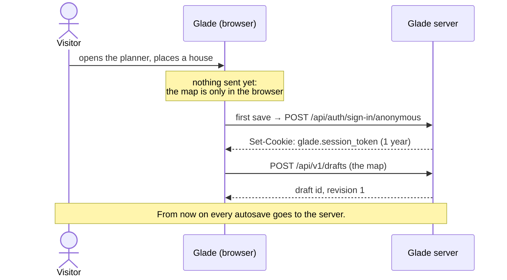
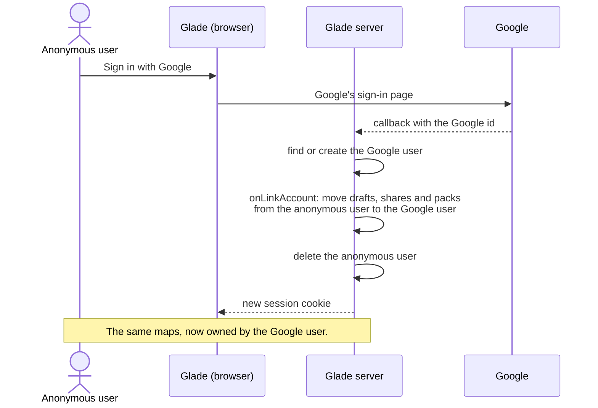

# Accounts and sessions

> **In short:** Nobody signs up. The first time you save, Glade quietly makes an **anonymous
> account** for you and remembers it with a cookie. Your maps belong to that account. **Sign in
> with Google** is optional: it keeps your maps safe and puts them on all your devices. There are no
> passwords and no keys to copy. [Better Auth](https://www.better-auth.com) does the work, inside
> Glade's own server and SQLite file.

## Who owns what

| You are…              | How Glade knows you       | What you can do                               |
| --------------------- | ------------------------- | --------------------------------------------- |
| A visitor (no saves)  | It doesn't                | Open shared links, look around, start a map   |
| Anonymous             | A cookie in this browser  | Everything: save, share, copy, build packs    |
| Signed in with Google | A cookie + your Google id | Everything, on every device where you sign in |

A map or pack has exactly **one owner**. Only the owner can change it. Other people make their own
copy ([sharing](sharing.md)). So there are no edit keys, no edit links and nothing to take back.

## The anonymous account



1. Opening Glade makes **no** account. Looking around is free, and bots don't fill the database.
2. The **first save** makes the account: the first autosave of a new map, or **Make a copy** of a
   shared one.
3. The account has no name and no email. Better Auth's anonymous plugin marks it with
   `isAnonymous: true`.
4. The cookie lasts **1 year** and renews on every visit. Someone who comes back once a year never
   loses their maps.

**The one risk:** an anonymous account lives in one browser's cookie. Clearing site data, or a new
device, means a new empty account. Nobody can get the old one back, not even the site owner. That is
why Glade nudges people to sign in.

| When                     | Nudge (a pill, never a blocking dialog)                   |
| ------------------------ | --------------------------------------------------------- |
| After the first share    | "Sign in with Google so you don't lose this map."         |
| When the 3rd map is made | "Sign in to keep your maps on all your devices."          |
| Settings → Account       | Always shows **Sign in with Google** for anonymous users. |

A nudge shows once. **Download all my maps** (Settings → Account) is always there as a backup.

## Sign in with Google

Google is the only sign-in. No passwords means no "forgot password" emails, no email checks and no
password storage.



| Case                                          | What happens                                                                   |
| --------------------------------------------- | ------------------------------------------------------------------------------ |
| First time with this Google account           | A Google user is made. Everything from the anonymous user moves to it.         |
| This Google account already has maps (laptop) | Everything from this browser's anonymous user is **added** to the Google user. |
| Already signed in on this device              | Nothing to move.                                                               |

Moving is one database transaction: it changes the `owner_id` of every draft, shared map and pack.
Nothing is copied, and share links keep working.

**Later, maybe:** Discord sign-in (many players use it). With Better Auth it is one more config
block (Q-27).

## Sessions

| Item          | Value                                          | Why                                                        |
| ------------- | ---------------------------------------------- | ---------------------------------------------------------- |
| Cookie name   | `glade.session_token`                          | Better Auth's cookie, with the `glade` prefix              |
| Cookie flags  | `HttpOnly`, `Secure`, `SameSite=Lax`, `Path=/` | Scripts can't read it; other sites can't send it on a POST |
| Lifetime      | 365 days, renewed once a day while used        | Anonymous users stay "signed in" while they keep coming    |
| Stored where  | Better Auth's `session` table in `glade.db`    | One file, one backup                                       |
| Other cookies | None                                           | No tracking, no cookie banner needed                       |

**Why a server cookie and not browser storage:** Safari deletes a site's browser storage
(IndexedDB, localStorage) after 7 days without a visit. A cookie set by the server, on the same
site, is not hit by that rule. So the account survives, and the maps live on the server.

### Signing out

| You are               | Sign out                                                                                         |
| --------------------- | ------------------------------------------------------------------------------------------------ |
| Signed in with Google | Clears the cookie and this browser's cached maps. Your maps stay on the server.                  |
| Anonymous             | **Hidden.** Signing out would lose the maps forever. Settings offers **Delete my data** instead. |

### Many devices

Sign in with Google on each device. Each device has its own session. **Settings → Account →
Devices** lists them (browser, last used) with **Sign out** on each.

### Two devices editing the same map

Each draft has a **revision** number. A save says which revision it started from. If another
device saved first, the server answers `409`, and Glade asks:

| Choice                     | Does                                                              |
| -------------------------- | ----------------------------------------------------------------- |
| **Keep both**              | This device's version becomes a new draft: "Beach island (copy)". |
| **Use the other device's** | Loads the newer one. This device's version is kept as a copy.     |
| **Use this device's**      | Saves over it.                                                    |

This only happens to one person on two devices at once, so it is rare.

## Deleting an account

**Settings → Account → Delete my account** (anonymous users see **Delete my data**).

| Thing                                            | What happens                                                                |
| ------------------------------------------------ | --------------------------------------------------------------------------- |
| User, sessions, Google link                      | Deleted at once.                                                            |
| Drafts                                           | Deleted at once.                                                            |
| Shared maps                                      | No longer shared. Their links say "This map was removed by its author."     |
| Shared packs that nobody else uses               | No longer shared.                                                           |
| Shared pack versions used by other people's maps | Kept, with no owner, so those maps don't break ([packs](sharing.md#packs)). |
| Copies other people made of your maps            | Untouched. They belong to those people.                                     |

## Clean-up

A monthly job removes anonymous accounts that are **both**:

- not used for 12 months (no session renewed), and
- have nothing published.

Signed-in accounts are never removed automatically.

## Admin

There is no admin role in the web app. The site owner runs `glade-admin` on the server
([running the site](admin.md)).

## What Glade stores about people

| Stored                                                       | Not stored                                            |
| ------------------------------------------------------------ | ----------------------------------------------------- |
| Anonymous users: an id and dates. No name, no email.         | Passwords (there are none)                            |
| Google users: Google id, email, name and picture from Google | Anything from Google beyond those                     |
| Sessions: browser family and last-used date                  | IP addresses (only counted in memory for rate limits) |
| Your drafts, shares and packs                                | Analytics, tracking cookies                           |

The email is used for sign-in and to show "Signed in as …". Glade sends no emails. A short privacy
page (`/privacy`) says all of this in plain words. Shared maps show no author name in 1.0 (Q-28).

## Setup

| Setting                                    | Where                                                         |
| ------------------------------------------ | ------------------------------------------------------------- |
| `BETTER_AUTH_SECRET` (32+ random bytes)    | Server env (secret)                                           |
| `BETTER_AUTH_URL` (`https://glade.app`)    | Server env                                                    |
| `GOOGLE_CLIENT_ID`, `GOOGLE_CLIENT_SECRET` | Server env (secret), from Google Cloud Console → OAuth client |

Google's redirect URL is `https://glade.app/api/auth/callback/google`. In development, a second
Google OAuth client uses `http://localhost:5173`.

```ts
// apps/server/src/auth/auth.ts (sketch)
export const auth = betterAuth({
  database: db, // the same better-sqlite3 file as the rest of Glade
  advanced: { cookiePrefix: "glade" },
  session: { expiresIn: 60 * 60 * 24 * 365, updateAge: 60 * 60 * 24 },
  socialProviders: {
    google: { clientId: env.GOOGLE_CLIENT_ID, clientSecret: env.GOOGLE_CLIENT_SECRET },
  },
  plugins: [
    anonymous({
      onLinkAccount: ({ anonymousUser, newUser }) =>
        moveOwnership(anonymousUser.user.id, newUser.user.id),
    }),
  ],
});
```
