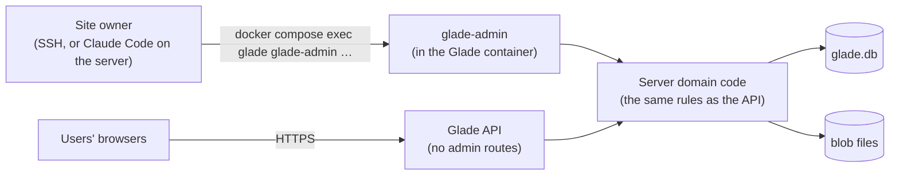
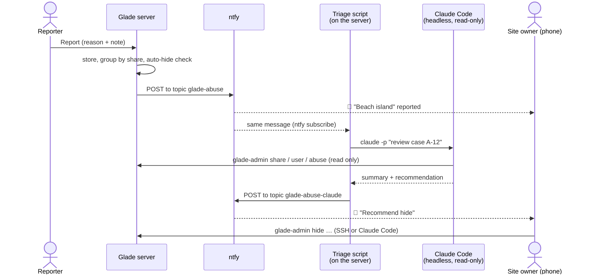

# Running the site (admin)

> **In short:** Glade has **no admin page and no admin role** in the web app. The site owner runs a
> command-line tool, `glade-admin`, on the server itself: by hand, or through Claude Code on the
> server. Only someone with shell access to the server can use it, so the website has nothing
> extra to attack.

## How it fits



- `glade-admin` ships in the Docker image (`apps/server/src/cli/admin.ts`).
- It calls the **same domain code** as the API. Example: `hide` does exactly what the server
  would do, including the "removed" message on the link. It never writes SQL by hand.
- SQLite runs in WAL mode, so the tool and the running server can use `glade.db` at the same time.

Every command runs like this, from the folder with `compose.yml`:

```sh
docker compose exec glade glade-admin stats
```

## Commands

**Read** (change nothing)

| Command                     | Shows                                                                     |
| --------------------------- | ------------------------------------------------------------------------- |
| `stats`                     | Users (anonymous / Google), drafts, shares, open abuse reports, disk used |
| `abuse` · `abuse <case id>` | Open abuse cases, newest first · one case with every report and its note  |
| `share <share id>`          | A share: owner id, versions, status, how many copies, abuse reports       |
| `user <user id \| email>`   | A user: anonymous or Google, dates, how many drafts and shares, banned?   |
| `bugs`                      | Open bug reports: id, date, app version, summary                          |
| `bugs get <report id>`      | Saves the report's `.gladelog` (and map, if sent) to the current folder   |
| `log`                       | The `admin_log`: every change made with this tool                         |

**Change** (each shows what it will do, then needs `--yes`)

| Command                          | Does                                                                                                                                                               |
| -------------------------------- | ------------------------------------------------------------------------------------------------------------------------------------------------------------------ |
| `hide <share id> --reason "…"`   | The share link says "removed". Maps that use a hidden pack version show grey stubs.                                                                                |
| `unhide <share id>`              | Undoes `hide`.                                                                                                                                                     |
| `ban <user id> --reason "…"`     | The user can't share any more. Their shares are hidden. Their drafts stay.                                                                                         |
| `unban <user id>`                | Undoes `ban`. Hidden shares stay hidden until `unhide`.                                                                                                            |
| `dismiss <case id>`              | Closes an abuse case: the reports were wrong. An auto-hidden map comes back.                                                                                       |
| `bugs close <report id>`         | Marks a bug report done.                                                                                                                                           |
| `delete-user <user id \| email>` | Deletes an account, the same as **Delete my account** ([accounts](accounts.md#deleting-an-account)). For privacy requests by email. Takes a database backup first. |

**Options for every command**

| Option        | Does                                                                |
| ------------- | ------------------------------------------------------------------- |
| `--json`      | Prints JSON instead of a table. Easier for scripts and Claude Code. |
| `--dry-run`   | For change commands: shows what would happen, changes nothing.      |
| `--by <name>` | Who is acting, saved in `admin_log`. Default: the shell user.       |

Bug reports are read with the separate `glade-log` tool ([logging](../logging/README.md)), which
also works on a laptop. A usual round:

```sh
docker compose exec glade glade-admin bugs get R-7F3K   # saves R-7F3K.gladelog
pnpm glade-log show R-7F3K.gladelog                     # on your laptop, or the server
```

## Abuse reports

> **In short:** A report reaches your phone within seconds as a push message from **ntfy**, with
> the map's name, the reason and a thumbnail. Claude Code on the server reads the case and sends a
> second message with a recommendation. You decide and act. If 3 people report the same map, the
> server hides it straight away until you review it.



### Reporting

1. A share link's **⋯** menu has **Report**.
2. The reporter picks a reason (Offensive · Spam · Personal information · Stolen work · Other)
   and can add a note (500 characters).
3. Reporting needs a session, so the first report quietly makes an anonymous account
   ([accounts](accounts.md#the-anonymous-account)). This lets the server count **different**
   reporters.
4. One user can report one share once. At most 20 reports per user per day.

### Cases

Reports on the same share are grouped into one **case** (`A-12`). Five reports on "Beach island"
give one case with 5 reports, and one alert, not five.

| Case status  | Meaning                                            | The share link shows        |
| ------------ | -------------------------------------------------- | --------------------------- |
| Open         | Reported, waiting for you                          | The map, as normal          |
| Under review | Auto-hidden ([below](#auto-hide)), waiting for you | "This map is under review." |
| Hidden       | You ran `hide`                                     | "This map was removed."     |
| Dismissed    | You ran `dismiss`: the reports were wrong          | The map, as normal          |

After a dismiss, new reports on the **same version** only alert you. They can't auto-hide it
again. A new version starts fresh.

The owner of a map under review sees **⚠ Under review** on its Library card. They can still edit
their draft.

### Auto-hide

When **3 different users** report the same share within 24 hours, the server sets the case to
**Under review** at once and sends a high-priority alert. Abuse doesn't stay up while you sleep.

- Only reporters whose account is at least 1 day old count, so someone can't make 3 fresh
  accounts and take a map down.
- You review it later: `glade-admin hide` to keep it down, or `glade-admin dismiss` to put it
  back.

### Alerts with ntfy

[ntfy](https://ntfy.sh) is a free, open-source push service with a phone app (iOS and Android). The
server sends one HTTP POST per new case, and once more when a case reaches auto-hide. Nothing is
sent for the 2nd, 3rd… report until then.

| Alert part | Example                                                                |
| ---------- | ---------------------------------------------------------------------- |
| Title      | `🚩 A-12 · "Beach island" reported`                                    |
| Body       | `Offensive · 1 report · map · shared 3 days ago` + the reporter's note |
| Image      | The snapshot's thumbnail                                               |
| Tap        | Opens the share link                                                   |
| Priority   | Normal. High when auto-hidden.                                         |

**Where ntfy runs:** self-hosted, as one more container next to Glade, behind Tailscale or with an
access token. Your map names and reporters' notes then never leave your server. A self-hosted ntfy
sends iOS alerts through ntfy.sh's relay (`upstream-base-url`), which only carries a "new message"
signal, not the content. The public ntfy.sh with a long secret topic name also works, for a quick
start.

| Setting            | Example                                        |
| ------------------ | ---------------------------------------------- |
| `GLADE_NTFY_URL`   | `https://ntfy.your-tailnet.ts.net/glade-abuse` |
| `GLADE_NTFY_TOKEN` | An ntfy access token that may only publish     |

With no `GLADE_NTFY_URL` (in development), the server only logs the case. If a POST to ntfy fails,
the server retries for an hour and counts `glade_notify_failed_total`.

**Backup alerts:** the metrics alerts still run, so you hear about reports even if ntfy is down:

| Metric                      | Alert when                |
| --------------------------- | ------------------------- |
| `glade_abuse_reports_open`  | Above 0 for a day         |
| `glade_notify_failed_total` | Any failure               |
| `glade_reports_total`       | Any new bug report (info) |

These sit with the other alerts in [CI and deploy](../engineering/ci-and-deploy.md#monitoring).

### Claude triage

A small script on the server, `glade-triage`, listens to the `glade-abuse` topic with
`ntfy subscribe`. For each new case it runs Claude Code in headless mode (one prompt, no chat
window):

```sh
claude -p "Review abuse case A-12. Use only glade-admin read commands with --json.
Summarise what the map and its owner look like, and recommend: dismiss, hide, or hide and ban.
Say how sure you are." \
  --allowedTools "Bash(docker compose exec glade glade-admin share:*)" \
                 "Bash(docker compose exec glade glade-admin user:*)" \
                 "Bash(docker compose exec glade glade-admin abuse:*)"
```

The script posts Claude's answer to a **second** topic, `glade-abuse-claude`, so it can't trigger
itself. Your phone follows both topics. Example:

> 🤖 **A-12:** The map name contains a slur. The owner had 2 maps hidden before. Recommend **hide
> and ban**. Sure: high.

| Rule                                   | Why                                                                                 |
| -------------------------------------- | ----------------------------------------------------------------------------------- |
| Claude gets **read** commands only     | Claude recommends; you decide. Nothing is hidden or banned by Claude.               |
| One run per case, not per report       | Saves cost, and avoids a pile of messages.                                          |
| Claude reads text and data, not images | Offensive **shapes** (like words drawn with paths) need your eyes on the thumbnail. |

The script and its systemd unit live in `docker/triage/`. It runs on the host, where Claude Code is
installed and signed in, not inside the Glade container.

### Acting on a case

**Now (option A):** the alert links to the map. You act over SSH, or by asking Claude Code on the
server ("hide A-12"), which asks before running a change command
([below](#using-it-with-claude-code)).

```sh
docker compose exec glade glade-admin hide 7Hq2xV9 --reason "slur in the name" --yes
docker compose exec glade glade-admin ban u_3kf9 --reason "repeat" --yes
docker compose exec glade glade-admin dismiss A-12 --yes          # the reports were wrong
```

**Later, if SSH from a phone gets tiresome (option B):** ntfy alerts get buttons (**Hide**,
**Dismiss**, **Hide and ban**). A button sends an HTTP request from your phone to a tiny admin
listener on its own port, bound **only** to the server's Tailscale address. The public website
still has no admin routes, and only your devices on Tailscale can reach the listener. It calls the
same domain code as `glade-admin` and writes to `admin_log` too.

## Using it with Claude Code

Claude Code on the server can run `glade-admin` like any command. Some guard rails:

| Rule                                                     | Why                                                                     |
| -------------------------------------------------------- | ----------------------------------------------------------------------- |
| Allow **read** commands without asking                   | `stats`, `abuse`, `share`, `user`, `bugs`, `log` are safe.              |
| Ask before every **change** command                      | `hide`, `ban`, `delete-user` affect real people.                        |
| Never let it run `sqlite3` on `glade.db` or edit `/data` | `glade-admin` is the only way to change data, so the rules always hold. |
| Use `--json` and `--by claude`                           | Clear output, and `admin_log` shows what Claude did.                    |

Example of a permission list for Claude Code on the server (`.claude/settings.json` in the folder
with `compose.yml`):

```json
{
  "permissions": {
    "allow": [
      "Bash(docker compose exec glade glade-admin stats:*)",
      "Bash(docker compose exec glade glade-admin abuse:*)",
      "Bash(docker compose exec glade glade-admin share:*)",
      "Bash(docker compose exec glade glade-admin user:*)",
      "Bash(docker compose exec glade glade-admin bugs:*)",
      "Bash(docker compose exec glade glade-admin log:*)"
    ],
    "deny": ["Bash(sqlite3:*)"]
  }
}
```

Note: `bugs close` starts with `bugs`, so it is allowed too. That is fine: closing a bug report
changes nothing for users. Every command that changes something for users (`hide`, `unhide`,
`ban`, `unban`, `dismiss`, `delete-user`) has its own name, so no read rule can match it.
