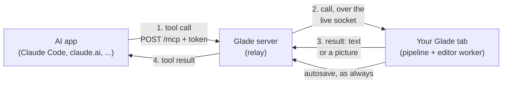
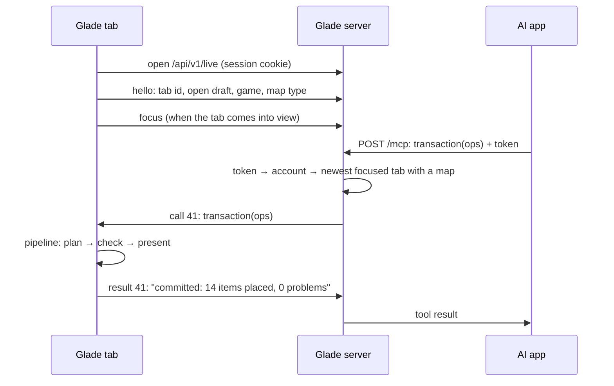

# AI apps (MCP)

> **In short:** Glade has a live **MCP server** at `/mcp`. You add it to an AI app (Claude Code,
> claude.ai, or any app that speaks MCP), log in and click **Allow** on a Glade page once, and the
> app can read and edit your maps. Connecting needs a logged-in account. The map lives in your open Glade tab, so **Glade must be open**: the server
> passes each tool call to that tab, the tab runs it like any other edit, and you see the change at
> once. With no tab open, every tool answers "Open Glade".

## The picture

The server does not edit maps. It checks the token, finds your tab and passes the call on. The tab
does the work, with the same pipeline, rules and undo as your own clicks. So:

| Because the tab does the work  | Which means                                                          |
| ------------------------------ | -------------------------------------------------------------------- |
| The change is drawn in the tab | You see it at once. No reload, no polling.                           |
| It goes through the pipeline   | The profile's rules check it, the same as a drag or a click.         |
| It is a normal transaction     | One undo step. ⌘Z takes it back.                                     |
| The tab saves it               | Normal autosave. No second writer, so no `409` and no lost edits.    |
| The tab has a 3D view          | It can draw a picture for the app. The server never needs a browser. |

## Connecting an app

Connecting needs a **logged-in account** (Google). Anonymous accounts can't connect, because an
anonymous account is one cookie in one browser:

| Case                                                      | Logged in | If anonymous were allowed                             |
| --------------------------------------------------------- | --------- | ----------------------------------------------------- |
| Claude Code on your Mac, Glade open in Chrome on that Mac | ✅        | ✅ only if you clicked Allow in Chrome                |
| Claude Code on your Mac, Glade open on your phone         | ✅        | ❌ the phone is another account                       |
| The Allow page opens in Safari; you use Glade in Chrome   | ✅        | ❌ Safari makes a new, empty account; nothing matches |

1. Add Glade to the app. Each app has its own screen for this; the address is always the same.

   | App         | How                                                                     |
   | ----------- | ----------------------------------------------------------------------- |
   | Claude Code | `claude mcp add --transport http glade https://<site>/mcp`, then `/mcp` |
   | claude.ai   | Settings → Connectors → Add custom connector → `https://<site>/mcp`     |
   | Others      | Their "add MCP server" screen, with `https://<site>/mcp`                |

2. The app opens a Glade page in your browser. If that browser isn't logged in, the page asks you
   to log in first:

   > **Log in to connect Claude Code**
   > AI apps need an account, so they can find your maps on any device. Maps you made in this
   > browser come with you.
   >
   > **[Continue with Google]**

   Logging in moves this browser's anonymous maps to your account, as usual
   ([log in](accounts.md#log-in)). Then the page asks:

   > **Allow Claude Code to use Glade?**
   > It will be able to see and change the map you have open, and open your other maps.
   > It can't share, delete or change your account.
   >
   > **[Allow]** [Cancel]

3. Done. The app shows up in **Settings → Account → MCP**.

A connection belongs to the app and your account, not to a device. The app keeps the token: Claude
Code keeps it on that computer, claude.ai keeps it in your Claude account (so it works in Claude's
web, desktop and phone apps).

### Settings → Account → MCP

One section on the Account tab. The instructions are always there, folded away. Connected apps sit
above them.

**No apps connected:**

> **MCP**
> Connect an AI app, like Claude, to make maps with you.
>
> ▸ **How to connect**

**Apps connected:**

> **MCP**
>
> ▾ **Connected apps (2)**
>
> | App         | Connected   | Last used    |                |
> | ----------- | ----------- | ------------ | -------------- |
> | Claude Code | 3 Oct 2026  | 2 hours ago  | **Disconnect** |
> | Claude      | 12 Oct 2026 | Today, 10:14 | **Disconnect** |
>
> ▸ **How to connect**

**How to connect**, opened in place (not a new window):

> 1. Copy the address: `https://<site>/mcp` **[Copy]**
> 2. Add it to your AI app:
>    - **Claude Code:** run `claude mcp add --transport http glade https://<site>/mcp`, then `/mcp`.
>    - **Claude (web, desktop, phone):** Settings → Connectors → Add custom connector.
>    - **Other apps:** their "add MCP server" screen.
> 3. Your browser opens a Glade page. Click **Allow**.
> 4. Keep Glade open while the app works. The app changes the map you have open.
> 5. More help: [Guide → AI apps].

| Part            | Detail                                                                                                                       |
| --------------- | ---------------------------------------------------------------------------------------------------------------------------- |
| Connected apps  | Collapsible, open by default. Hidden when there are none.                                                                    |
| How to connect  | Collapsible, closed by default. Glade remembers if you opened it, on this device.                                            |
| Disconnect      | Asks once ("Disconnect Claude Code? It can't use Glade until you connect it again."), then removes the app's tokens at once. |
| Anonymous users | The section shows "AI apps need an account." with a **Log in** button, and the same **How to connect**.                      |

The sign-in standard is **OAuth 2.1**. Better Auth's MCP plugin (`@better-auth/mcp`) makes Glade's
server the sign-in provider: it registers the app, shows the Allow page and gives the app a token
tied to your account. Nothing outside Glade's server and SQLite file is involved.

## Glade must be open

### What the app sees

| Your browser                           | Tools answer                                                                                                  |
| -------------------------------------- | ------------------------------------------------------------------------------------------------------------- |
| No Glade tab open                      | `error: Glade isn't open. Open https://<site> in a browser where you use Glade, then try again.`              |
| Glade open, no map (Library, Home)     | `error: No map is open in Glade. Open a map, or call open_map.` (`list_maps`, `open_map` and `new_map` work.) |
| A map open                             | The result.                                                                                                   |
| Open, but signed in to another account | `error: Glade is open, but signed in to another account than the one this app uses.`                          |

The connection itself always succeeds, open tab or not. `glade_status` says which state you're in.

**Why not fail the connection instead:** an app connects once, when it starts. If Glade isn't open
at that moment, the connection would fail and stay failed: opening Glade later doesn't fix it, and
you would reconnect by hand. Most apps also show a failed connection as a plain "failed" without
the server's message, and the AI gets no tools at all, so it can't tell you what's wrong. A tool
error reaches the AI in every app, and the AI passes the message on.

**Why not hide the tools while Glade is closed:** MCP lets a server change its tool list
(`notifications/tools/list_changed`), but apps don't all follow it, so a hidden tool might stay
hidden. Glade keeps one fixed tool list.

### The live socket

While Glade is open and you have an account, the tab keeps a WebSocket to the server.

| Item                | Value                                                                                |
| ------------------- | ------------------------------------------------------------------------------------ |
| Socket              | `GET /api/v1/live` (WebSocket), session cookie                                       |
| Tab says            | `hello` on open, `focus` when it comes into view, `map` when it opens another map    |
| Heartbeat           | Every 20 s. A tab silent for 45 s counts as closed.                                  |
| Call time limit     | 20 s, then `error: Glade didn't answer in time.`                                     |
| Where tabs are kept | In the server's memory. Glade's server is one process, so no shared store is needed. |

### Which tab gets the call

The **most recently focused** tab with a map open. Example: the island is open on your laptop and a
home on your phone. You last looked at the laptop, so the app works on the island. `glade_status`
names the map: `Working on "Spring island" (Petit Planet, island), in the tab you used last.`

The server matches by **account**, not device. So Claude Code on your Mac can work on the map open
on your phone. Phone browsers cut a page's connection soon after it leaves the screen (iPhone
Safari within seconds), so a phone tab only answers while Glade is on screen. Off screen, tools
answer "Glade isn't open" until you come back.

## Tools

The tool list is the same for every game, because Glade's controls are the same for every game
([the idea](../architecture.md#the-idea-consistency-in-differences)). What differs per game comes
from `map_info`, which reads the game's profile: its grids, kinds, rules and ops.

| Tool                  | Does                                                                                        | Example                                                   |
| --------------------- | ------------------------------------------------------------------------------------------- | --------------------------------------------------------- |
| `glade_status`        | Is Glade open, which map, which game. Works with no tab.                                    | `Glade isn't open.`                                       |
| `map_info`            | The open map's grids, rule list, op list and catalog categories. Call once.                 | `island: 160 × 144 tiles, 10 × 9 areas, rules F1–F4, ...` |
| `describe`            | Text about the map or one area: what is where, heights, problems.                           | `area 3,3: plateau height 2, pond at 4,5, 3 lamps`        |
| `view`                | A grid of one layer in a box, as text, with coordinates.                                    | Heights of tiles 20–40 × 10–20                            |
| `search_items`        | Search the catalog and loaded packs.                                                        | `"small lamp"` → 4 items with ids and footprints          |
| `get_selection`       | What you selected in the tab, so "here" means something.                                    | `box 12,4 → 20,9 (tiles)`                                 |
| `get_picture`         | A PNG of the map, drawn by the tab. For looks only; use `describe` for facts.               | `camera: "iso"`, `box: area 3,3`                          |
| `transaction`         | Run ops as one change. Rejected if it adds a problem.                                       | `[{op: "place", item: "lamp-small", x: 12, y: 4}]`        |
| `check`               | The open map's problems, or the problems a set of ops would add, without changing anything. | `F2 at 14,6: fence needs a free tile`                     |
| `undo`, `redo`        | The tab's undo and redo.                                                                    | `undid "Claude: place 14 items"`                          |
| `list_maps`           | Your maps. Works with no map open.                                                          | `Spring island (island), Cottage (home), ...`             |
| `open_map`, `new_map` | Make the tab open a map, or a new one.                                                      | `new_map(game: "petit-planet", type: "island")`           |

**Pack tools** (make a pack, add an item from a builder recipe) come with the builder
([builder](../builder/README.md)) and follow the same pattern: the builder in the tab does the work.

**Text first, pictures for looks.** `describe` and `view` give exact facts and coordinates.
`describe` uses the game's `describe` text from its `ui` package, the same text the screen reader
uses ([accessibility](../ui/accessibility.md)), so one piece of code serves both.

### What tools can't do

No tool can **share**, **delete**, **download my data** or change the account. These are actions
with effects outside the map, and they stay with you, in the tab.

## A call inside the tab

A call goes through the [action pipeline](../planner/internals.md#the-action-pipeline) like a click,
with all five steps.

| Step         | For a call from an app                                                                               |
| ------------ | ---------------------------------------------------------------------------------------------------- |
| 1. Capture   | The socket message becomes an `AppCall` event (app name, call id, tool, arguments).                  |
| 2. Interpret | `AppCall` becomes an intent: `AppEdit { ops }` for `transaction`, or a read intent for the others.   |
| 3. Plan      | Checks each op is in the map type's op table. Label: `Claude: place 14 items`.                       |
| 4. Check     | The worker runs the transaction and the rules, as always.                                            |
| 5. Present   | Draws the change, flashes the changed area, adds a note, autosaves, logs, and sends the result back. |

The note says who did it and offers undo: **"Claude placed 14 items · Undo"**. While a call runs, the
viewport shows a small **Claude is working** badge with the app's name.

Calls and your own actions share the pipeline, so they run **one at a time**. Example: you are
dragging a chair when a call arrives. The call waits until you let go, then runs on the map with the
chair in its new place.

## Pictures

`get_picture` asks the tab to draw the map off-screen with `MapScene` and send back a PNG. The app
gets it as an MCP image.

| Option   | Values                                                                            | Default   |
| -------- | --------------------------------------------------------------------------------- | --------- |
| `camera` | `top` (from above, north up), `iso` (35°), `low` (15°), `view` (what you see now) | `iso`     |
| `box`    | A box in the map's grid, or `area x,y`                                            | Whole map |
| `size`   | Width in pixels, 256–1024                                                         | 512       |

The picture uses the look the tab shows now (time of day, season).

## Limits and safety

| Item                  | Value                                                                                           |
| --------------------- | ----------------------------------------------------------------------------------------------- |
| Token scope           | One scope, `maps`: see and change your maps through your open tab.                              |
| Tokens                | Better Auth's defaults. **Disconnect** removes the app's tokens at once.                        |
| Calls                 | 60 per minute per app. More gets `429` with a wait time.                                        |
| Ops per `transaction` | 5,000. Bigger changes are split by the app.                                                     |
| Who can reach a tab   | Only calls whose token owner is the tab's signed-in user. The server checks both on every call. |
| Logs                  | `mcp.call` events: tool name, time, result kind. Never arguments or map content.                |

Everything a tool returns is about your own map, so nothing from other people reaches the app.

## API

| Method        | Path                                      | Needs   | Does                                                        |
| ------------- | ----------------------------------------- | ------- | ----------------------------------------------------------- |
| `POST`, `GET` | `/mcp`                                    | Token   | The MCP server (Streamable HTTP).                           |
| `GET`         | `/api/v1/live`                            | Session | The tab's live socket (WebSocket).                          |
| `GET`         | `/.well-known/oauth-protected-resource`   | —       | Tells apps where to sign in (from the Better Auth plugin).  |
| `GET`         | `/.well-known/oauth-authorization-server` | —       | The sign-in endpoints (from the Better Auth plugin).        |
| —             | `/api/auth/oauth2/*`                      | —       | Register, Allow page, tokens (from the Better Auth plugin). |

## Where the code goes

| Part                                          | Place                                                   |
| --------------------------------------------- | ------------------------------------------------------- |
| `/mcp`, the tool list, the relay, OAuth setup | `apps/server/src/mcp/`                                  |
| The live socket, server side                  | `apps/server/src/live/`                                 |
| The live socket in the tab, `AppCall` events  | `apps/web/src/platform/live/`                           |
| Turning calls into intents and results        | `packages/planner` (pipeline steps 2 and 5)             |
| Text about a map (`describe`)                 | Each game's `ui` package, shared with the screen reader |
| Pictures                                      | `packages/viewport` (off-screen `MapScene`)             |

The tool list is game-free and names no game. A tool reads game facts from the profile of the
open map.
