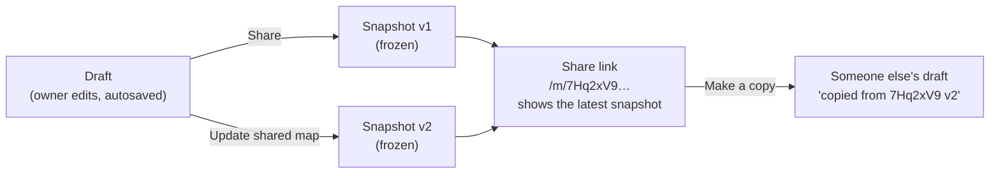
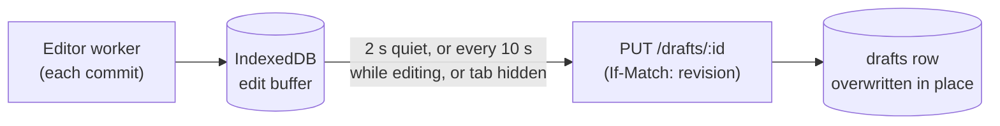
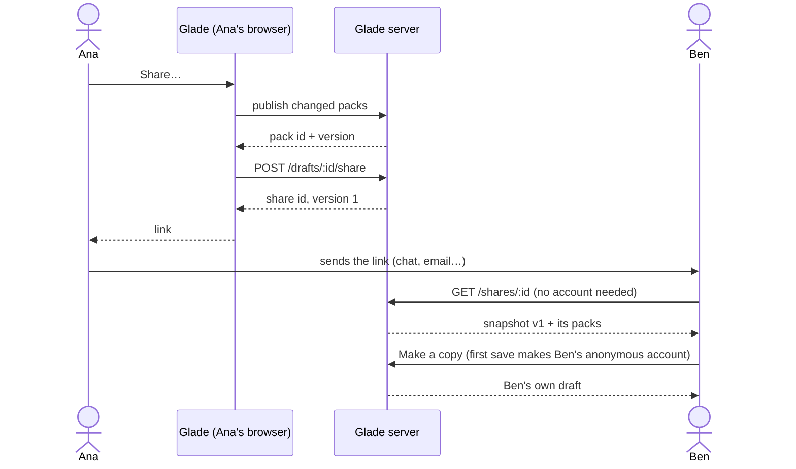

# Saving, library and sharing

> **In short:** Your maps and packs are **drafts**, saved to the server as you work and owned by
> your account ([accounts](accounts.md)). **Share** publishes a **snapshot**: a frozen copy that
> never changes, behind a link anyone can open. To edit someone's map, you **make a copy**. The
> copy is yours and doesn't depend on the original, so nothing breaks if the author changes or
> removes theirs.

## A map's life

| Step                     | Who    | What happens                                                                                                            | Can it change later? |
| ------------------------ | ------ | ----------------------------------------------------------------------------------------------------------------------- | -------------------- |
| 1. **Draft**             | Owner  | The map autosaves to the server, owned by the owner's account.                                                          | ✅ By the owner      |
| 2. **Share**             | Owner  | The server freezes the draft as snapshot v1 and returns a link.                                                         | ❌ Never             |
| 3. **Open the link**     | Anyone | Shows the latest snapshot, read-only. No account needed.                                                                | —                    |
| 4. **Make a copy**       | Anyone | A new draft for the visitor, with a note "copied from 7Hq2xV9 v1".                                                      | ✅ By the visitor    |
| 5. **Update shared map** | Owner  | Freezes the current draft as snapshot v2. The link now shows v2. v1 still exists.                                       | ❌ v1 never changes  |
| 6. **Make private**      | Owner  | The share switch goes to Private. The link shows the [private map page](#draft-urls). Copies from step 4 are untouched. | —                    |
| 7. **Make public again** | Owner  | The same link comes back with the **same** shared version. It does not update: the owner updates when they choose.      | —                    |

So:

- **Edit rights are always "only the owner".** No edit keys, no edit links, nothing to revoke.
- **A shared map can't be wiped from under people.** Each copy holds its own full map. Example: 40
  people copy Ana's island, then Ana makes it private. All 40 copies keep working.
- **Shared maps never update by themselves.** The owner decides when, with **Update shared map**.

## Drafts and autosave

1. Every commit is written to **IndexedDB** at once (debounced by 1 second). This is a buffer, so a
   closed tab or a dropped connection loses nothing.
2. The browser uploads the draft after **2 seconds** with no edits, at most every **10 seconds**
   while editing goes on, and when the tab is hidden.
3. The server **overwrites** the draft's row and adds 1 to its `revision`. Drafts keep no history
   on the server. Undo history lives in the browser.
4. The draft's map file is checked like any upload ([upload checks](README.md#upload-checks-in-order)).

Example: Amy places a brick, then another brick 1 second later. The server only ever sees the
2-brick map, because the first upload waits for 2 quiet seconds.

**Offline or server down:** editing goes on. Edits wait in IndexedDB and the map shows **⟳ Changes
waiting**. Glade retries with back-off and uploads when the server is back. Maps opened recently
are cached in IndexedDB, so they still open.

**Two devices at once:** see [accounts](accounts.md#two-devices-editing-the-same-map).

**Save points:** **Menu → Save map** makes a named save point of the current draft (Q-18). Save points
live in IndexedDB on this device.

## The Library

One window, opened from **Menu → Library** (Maps · Packs). It lists what your account owns, and the
shared maps you have opened.

| Part   | Detail                                                                                                                             |
| ------ | ---------------------------------------------------------------------------------------------------------------------------------- |
| Tabs   | **Maps** · **Packs**                                                                                                               |
| Filter | **All** · **Drafts** (your editable maps, including copies you made) · **Shared** · **View only** (other people's maps you opened) |
| Search | By name                                                                                                                            |
| Sort   | Last changed (default) · Name A–Z · Oldest first                                                                                   |
| Card   | Island thumbnail, name, when it last changed, badges                                                                               |
| Select | Tick cards; Select all / Select none; a bottom bar with **Delete**; an **Undo** toast after deleting.                              |
| Empty  | "No drafts", "Nothing shared yet", and a no-results message for search.                                                            |

| Card menu | Your own maps                                                          | View-only maps                                       |
| --------- | ---------------------------------------------------------------------- | ---------------------------------------------------- |
| Actions   | Open · Rename · Duplicate · Share / Copy link · Update shared · Delete | Open · Make a copy · Copy link · Remove from Library |

| Badge            | Meaning                                                            |
| ---------------- | ------------------------------------------------------------------ |
| Draft            | Yours, editable.                                                   |
| Shared           | Has a public share link.                                           |
| Unshared changes | Shared, and the draft has changed since the shared version.        |
| View only        | Someone else's shared map that you opened.                         |
| New changes      | The owner of a view-only map has updated it since you last looked. |

There is no Export: maps move between people by links ([no files](#no-files)).

**Delete** on a shared map asks: "Also make it private?" Deleting the draft but keeping it public
keeps the link working, with no owner draft behind it.

**Making a map private never deletes your draft**, and keeps its shared version for when you make it
public again. A draft that was never shared is never deleted (except by the
[clean-up](accounts.md#clean-up) of anonymous accounts unused for 12 months).

## Share a map, step by step

The **share chip** at the top right of the viewport (or **Menu → Share**) shows where a map stands and
opens the share dialog.

| State   | The chip says                                                          | The dialog has                                                             |
| ------- | ---------------------------------------------------------------------- | -------------------------------------------------------------------------- |
| Private | "Private: only you can see it. Click to share"                         | A Private / Public switch, and what will be shared (the map and its packs) |
| Public  | "Public: anyone with the link can view"                                | The switch, the link with **Copy link**, the shared version and when       |
| Changes | ✱ "Public, but your newest changes aren't shared yet. Click to update" | "Your version" next to the shared one, and **Update shared map**           |

While a public map has changes not shared yet, the save status reads "Saved just now · only you see
changes until you update".

1. Open the share chip.
2. The dialog lists what will be published: the map, and any of **your packs** it uses that have
   changes ("This map uses 2 of your packs. They will be shared too.").
3. Turn the switch to **Public**.
4. Glade publishes the packs, then the map.
5. You get one link with **Copy link**:
   `https://glade.app/petit-planet/planner/m/7Hq2xV9pLk3mRt8wZ4bN1`
6. The map's badge changes to Shared.

Turning the switch Public → Private → Public **does not** update the shared map: it brings back the
same shared version on the same link.

### Links

Every map has two ids: a **draft id** and, once shared, a **share id**. They are different random
strings, so a share link never gives away the draft id.

| Link                               | Example                                | Shows                                                             | Who can open it |
| ---------------------------------- | -------------------------------------- | ----------------------------------------------------------------- | --------------- |
| `/<game>/planner/d/<draft id>`     | `/petit-planet/planner/d/Xk82mQp4…`    | The draft, ready to edit. This is the address bar while you work. | The owner       |
| `/<game>/planner/m/<share id>`     | `/petit-planet/planner/m/7Hq2xV9…`     | The latest snapshot. A note says "Version 3 · 2 days ago".        | Anyone          |
| `/<game>/planner/m/<share id>?v=2` | `/petit-planet/planner/m/7Hq2xV9…?v=2` | Exactly version 2, forever. Good for guides and posts.            | Anyone          |

Opening a share link shows the map read-only ([view only](../planner/screen.md#someone-elses-map-view-only)):
no toolbox and no editing controls. A view bar offers **Make a copy**. If you open your **own** share
link, it says **Open my draft** instead. The **⋯** menu has the version note and **Report map**
([abuse reports](admin.md#abuse-reports)).

### Draft URLs

Someone who isn't the owner opens a draft URL:

| The draft is…             | They see                                                                            |
| ------------------------- | ----------------------------------------------------------------------------------- |
| Private, or doesn't exist | The **private map** page (below). Both cases look the same, so ids can't be probed. |
| Shared                    | A redirect to its share link, showing the latest snapshot.                          |

The redirect covers a common mistake: the owner copies the address bar instead of using
**Share…**. The owner already made that snapshot public, so the redirect gives nothing away.

The private map page, headed **"This map is private"** (the owner made the link private):

| You are    | The page offers                                                                                        |
| ---------- | ------------------------------------------------------------------------------------------------------ |
| Logged out | "Is this your map? Log in to open it." · **Log in** · **Go to Glade home** (and Log in in the top bar) |
| Logged in  | **Go to Glade home** · **Open my Library** · a "switch account" link                                   |

Never a silent redirect to a blank planner: that looks like the map loaded empty.

## Packs

Packs work like maps: a draft that only you change, frozen published versions, and copies.

| Rule                                                                                   | Why                                     |
| -------------------------------------------------------------------------------------- | --------------------------------------- |
| A pack has an id, a name, a game and a **version**.                                    | So maps can say exactly what they need. |
| Published versions never change. Publishing again makes a new version.                 | Old maps keep working.                  |
| A map stores which pack versions it uses.                                              | Opening a map loads exactly those.      |
| Your draft map may use your **draft** pack. Sharing the map publishes the pack first.  | A share link never points at a draft.   |
| When a newer pack version exists, the map shows "Pack update available".               | You choose when to update.              |
| A pack version that any map uses is **never deleted**, even after you make it private. | Nobody's map loses its items.           |
| Packs can be shared on their own, with the same kind of link.                          | Share an item set without a map.        |

**Making a pack private**, example:

1. Ana publishes "Garden pack v2".
2. Ben copies Ana's map, which uses Garden pack v2.
3. Ana makes the Garden pack private.
4. The pack's own link says "removed", and nobody new can add it.
5. Ben's map still loads Garden pack v2, because Ben's map uses Garden pack v2.

Only the site owner's `glade-admin hide` ([running the site](admin.md)) removes a pack version that maps use (for abuse). Those maps then show
grey stubs and "3 items are no longer available".

## No files

Glade has no file import or export. Maps and packs live on the server, found by their ids, and
links are how they move between people. The one exception is privacy: **Settings → Account →
Download my data** gives you a zip of everything Glade holds for you
([accounts](accounts.md#your-data)).

## What the server knows

| Stored                                                    | Not stored                          |
| --------------------------------------------------------- | ----------------------------------- |
| Your drafts and packs (once you save), and what you share | Anything you never saved            |
| Who owns each draft and share (an account id)             | Who opened a share link             |
| When things were created and changed                      | IP addresses (not kept in app logs) |
| Bug reports you choose to send                            | Analytics                           |

What is stored about the account itself is in [accounts](accounts.md#what-glade-stores-about-people).
